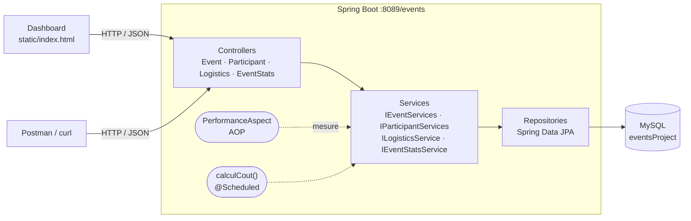
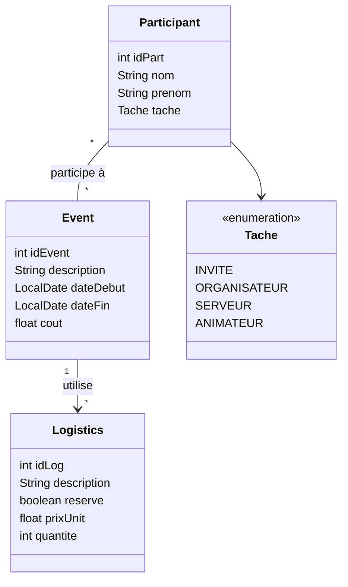

<p align="center">
  
</p>

<h1 align="center">Events Project — Gestion des événements</h1>

<p align="center">
  Application Spring Boot de gestion des événements, des participants et de la logistique<br>
  <b>Faculté des Sciences de Tunis</b> · Université de Tunis El Manar · IGL5 — Groupe 2
</p>

<p align="center">
  
  
  
  
  
</p>

---

## Sommaire

- [Présentation](#présentation)
- [Dashboard](#dashboard)
- [Stack technique](#stack-technique)
- [Architecture](#architecture)
- [Modèle de données](#modèle-de-données)
- [Démarrage rapide](#démarrage-rapide)
- [API REST](#api-rest)
- [Tests et couverture](#tests-et-couverture)
- [Structure du projet](#structure-du-projet)
- [Workflow Git](#workflow-git)
- [Dépannage](#dépannage)

---

## Présentation

**Events Project** permet d'organiser les événements de la faculté (journées portes ouvertes, hackathons, conférences, forums…) :

- **Événements** : création, dates de début et de fin, coût calculé automatiquement.
- **Participants** : gestion CRUD et affectation d'une tâche (`ORGANISATEUR`, `ANIMATEUR`, `SERVEUR`, `INVITE`).
- **Logistique** : matériel et services rattachés à un événement (prix unitaire, quantité, réservé ou non).
- **Statistiques** : par événement et globales (participants par tâche, taux de réservation, coût de la logistique réservée).
- **Dashboard web** aux couleurs de la FST, servi directement par l'application.
- **Tâche planifiée** (`@Scheduled`) qui recalcule régulièrement le coût des événements.
- **Aspect AOP** (`PerformanceAspect`) qui journalise le temps d'exécution de chaque méthode des services.

## Dashboard

Une fois l'application lancée : **<http://localhost:8089/events/>**

<p align="center">
  
</p>

| Zone | Contenu |
|---|---|
| Indicateurs clés | Nombre d'événements (à venir / passés), participants, logistique réservée, coût total réservé |
| Graphiques | Coût de la logistique réservée par événement · participants par tâche · composition des équipes par événement |
| Prochains événements | Frise chronologique avec compte à rebours |
| Tableau des événements | Recherche, filtre par intervalle de dates, durée, statut (à venir / en cours / terminé) |
| Participants et logistique | Listes filtrables, changement de tâche directement dans le tableau |
| Bouton « Ajouter » | Création d'un événement (avec ses participants), d'un participant ou d'une logistique |

> Le dashboard est une page statique (`src/main/resources/static/index.html`) qui consomme l'API REST. Chart.js est embarqué dans le projet, le dashboard fonctionne donc **sans connexion internet**.

**Données de démonstration** : au premier démarrage, si la base est vide, 6 événements, 12 participants et leur logistique sont insérés automatiquement (`DemoDataLoader`). Pour désactiver ce comportement :

```properties
# src/main/resources/application.properties
app.demo-data=false
```

## Stack technique

| Couche | Technologies |
|---|---|
| Langage | Java 8+ (configuré pour les JDK 8 à 26) |
| Framework | Spring Boot 2.7.6 (Web, Data JPA, AOP, Scheduling) |
| Persistance | Hibernate / JPA · MySQL 8 (application) · H2 en mémoire (tests) |
| Productivité | Lombok 1.18.46 |
| Tests | JUnit 4 & 5 · Mockito · MockMvc · Spring Boot Test |
| Qualité | JaCoCo 0.8.15 (couverture de code) |
| Front | HTML / CSS / JavaScript · Chart.js 4.4.1 |
| Build | Maven (wrapper `mvnw` inclus) |

## Architecture

Architecture en couches classique **Controller → Service → Repository → Base de données**.



## Modèle de données



- `Participant` est le **côté propriétaire** de la relation `ManyToMany` avec `Event`.
- `Event → Logistics` est une relation `OneToMany` unidirectionnelle, chargée en `EAGER`.
- Le coût d'un événement = somme de `prixUnit × quantite` des logistiques **réservées**.

## Démarrage rapide

### Prérequis

- **JDK 17** recommandé (le `pom.xml` est configuré pour les JDK 8 à 26)
- **MySQL 8** démarré sur `localhost:3306` (XAMPP, WAMP, Docker… au choix)
- Maven 3.6+ (ou le wrapper `mvnw` fourni)

### 1. Cloner le dépôt

```bash
git clone <url-du-depot>
cd IGL5-G2-EventsProjetcs
```

### 2. Configurer la base de données

La base `eventsProject` est créée automatiquement au démarrage. Par défaut, l'utilisateur est `root` sans mot de passe. Pour modifier, éditez `src/main/resources/application.properties` :

```properties
spring.datasource.url=jdbc:mysql://localhost:3306/eventsProject?createDatabaseIfNotExist=true&serverTimezone=UTC
spring.datasource.username=root
spring.datasource.password=
```

> Pour lancer MySQL rapidement avec Docker :
> ```bash
> docker run -d --name mysql-events -p 3306:3306 -e MYSQL_ALLOW_EMPTY_PASSWORD=yes mysql:8
> ```

### 3. Lancer l'application

```bash
mvn spring-boot:run
# ou, sous Windows : mvnw.cmd spring-boot:run
```

| Ressource | URL |
|---|---|
| Dashboard | <http://localhost:8089/events/> |
| Base de l'API | `http://localhost:8089/events` |

### 4. Construire le JAR

```bash
mvn clean package
java -jar target/eventsProject-1.0.0-SNAPSHOT.jar
```

## API REST

Toutes les routes sont préfixées par le context-path **`/events`** (ex. `http://localhost:8089/events/participant/all`).

### Statistiques — `/event-stats`

| Méthode | Route | Description |
|---|---|---|
| `GET` | `/event-stats` | Statistiques de tous les événements, triées par date |
| `GET` | `/event-stats/summary` | Indicateurs globaux du dashboard |
| `GET` | `/event-stats/{id}` | Statistiques d'un événement (`404` s'il n'existe pas) |
| `GET` | `/event-stats/upcoming` | Statistiques des événements à venir |
| `GET` | `/event-stats/between/{d1}/{d2}` | Événements dont la date de début est entre `d1` et `d2` (`yyyy-MM-dd`, `400` si `d1 > d2`) |

<details>
<summary>Exemple de réponse — <code>GET /event-stats/1</code></summary>

```json
{
  "idEvent": 1,
  "description": "Journée Portes Ouvertes FST",
  "dateDebut": "2026-10-27",
  "dateFin": "2026-10-27",
  "dureeJours": 1,
  "nbParticipants": 6,
  "participantsParTache": { "INVITE": 3, "ORGANISATEUR": 1, "SERVEUR": 1, "ANIMATEUR": 1 },
  "nbLogistics": 4,
  "nbLogisticsReservees": 3,
  "coutLogistiqueReservee": 2640.0
}
```
</details>

<details>
<summary>Exemple de réponse — <code>GET /event-stats/summary</code></summary>

```json
{
  "nbEvents": 6,
  "nbEventsAVenir": 4,
  "nbParticipants": 12,
  "nbLogistics": 18,
  "nbLogisticsReservees": 14,
  "tauxReservation": 77.78,
  "coutTotalLogistiqueReservee": 10960.0,
  "participantsParTache": { "INVITE": 6, "ORGANISATEUR": 2, "SERVEUR": 2, "ANIMATEUR": 2 }
}
```
</details>

### Événements — `/event`

| Méthode | Route | Description |
|---|---|---|
| `POST` | `/event/addPart` | Ajouter un participant |
| `POST` | `/event/addEvent` | Créer un événement et l'affecter aux participants listés dans `participants` |
| `POST` | `/event/addEvent/{id}` | Créer un événement et l'affecter au participant `{id}` |
| `PUT` | `/event/addAffectLog/{description}` | Ajouter une logistique à l'événement portant cette description |
| `GET` | `/event/getLogs/{d1}/{d2}` | Logistiques réservées des événements entre deux dates |

### Participants — `/participant`

| Méthode | Route | Description |
|---|---|---|
| `POST` | `/participant/add` | Créer un participant |
| `GET` | `/participant/all` | Lister tous les participants |
| `GET` | `/participant/{id}` | Détail d'un participant (`404` s'il n'existe pas) |
| `PUT` | `/participant/update/{id}` | Modifier nom, prénom et tâche |
| `PUT` | `/participant/{id}/tache/{tache}` | Changer uniquement la tâche |
| `DELETE` | `/participant/delete/{id}` | Supprimer un participant |

### Logistique — `/logistics`

| Méthode | Route | Description |
|---|---|---|
| `POST` | `/logistics` | Créer une logistique (`201`) |
| `PUT` | `/logistics` | Modifier une logistique |
| `GET` | `/logistics` | Lister toutes les logistiques |
| `GET` | `/logistics/{id}` | Détail d'une logistique |
| `GET` | `/logistics/reserved` | Lister les logistiques réservées |
| `GET` | `/logistics/{id}/cout` | Coût total (`prixUnit × quantite`) |
| `DELETE` | `/logistics/{id}` | Supprimer une logistique (`204`) |

### Exemples `curl`

```bash
# Créer un participant
curl -X POST http://localhost:8089/events/participant/add \
  -H "Content-Type: application/json" \
  -d '{"nom":"Tounsi","prenom":"Ahmed","tache":"ORGANISATEUR"}'

# Créer un événement affecté aux participants 1 et 2
curl -X POST http://localhost:8089/events/event/addEvent \
  -H "Content-Type: application/json" \
  -d '{"description":"Hackathon","dateDebut":"2026-11-05","dateFin":"2026-11-06","participants":[{"idPart":1},{"idPart":2}]}'

# Ajouter une logistique réservée à cet événement
curl -X PUT http://localhost:8089/events/event/addAffectLog/Hackathon \
  -H "Content-Type: application/json" \
  -d '{"description":"Pause-café","reserve":true,"prixUnit":6,"quantite":120}'

# Consulter les statistiques globales
curl http://localhost:8089/events/event-stats/summary
```

## Tests et couverture

Chaque fonctionnalité est testée de deux façons :

| Type | Principe | Base de données |
|---|---|---|
| **Avec Mockito** (`*MockTest`, `*MockitoTest`) | Repositories ou services simulés, test unitaire rapide | Aucune |
| **Sans Mockito** (`*Test`, `*IntegrationTest`) | Contexte Spring complet, vrais services et repositories | H2 en mémoire |

| Fonctionnalité | Tests avec Mockito | Tests sans Mockito |
|---|---|---|
| Événements | `EventServicesMockTest` | `EventServicesImplTest` |
| Participants | `ParticipantServicesImplMockitoTest`, `ParticipantRestControllerMockitoTest` | `ParticipantServicesImplIntegrationTest`, `ParticipantRestControllerIntegrationTest` |
| Logistique | `LogisticsServiceImplMockTest`, `LogisticsControllerMockTest` | `LogisticsServiceImplTest`, `LogisticsControllerTest` |
| Statistiques | `EventStatsServiceImplMockTest`, `EventStatsControllerMockTest` | `EventStatsServiceImplIntegrationTest` |

```bash
# Lancer tous les tests (rapport JaCoCo généré automatiquement)
mvn clean test

# Lancer une seule classe de test
mvn test -Dtest=EventStatsServiceImplMockTest
```

Le rapport de couverture est disponible dans **`target/site/jacoco/index.html`**.

> Les tests utilisent `src/test/resources/application.properties` (H2 en mémoire) : **MySQL n'est pas nécessaire pour lancer les tests**.

## Structure du projet

```
IGL5-G2-EventsProjetcs
├── pom.xml
├── docs/
│   └── dashboard.png
└── src
    ├── main
    │   ├── java/tn/fst/eventsproject
    │   │   ├── EventsProjectApplication.java   # point d'entrée (@EnableScheduling)
    │   │   ├── config/
    │   │   │   ├── PerformanceAspect.java      # AOP : temps d'exécution des services
    │   │   │   └── DemoDataLoader.java         # données de démo (app.demo-data=true)
    │   │   ├── controllers/                    # API REST
    │   │   ├── dto/                            # EventStatsDTO, GlobalStatsDTO
    │   │   ├── entities/                       # Event, Participant, Logistics, Tache
    │   │   ├── repositories/                   # Spring Data JPA
    │   │   └── services/                       # interfaces + implémentations
    │   └── resources
    │       ├── application.properties          # MySQL, port 8089, context-path /events
    │       └── static/                         # dashboard (index.html, logo, Chart.js)
    └── test
        ├── java/tn/fst/eventsproject
        │   ├── controllers/
        │   └── services/
        └── resources/application.properties    # H2 en mémoire pour les tests
```

## Workflow Git

- `main` : branche stable.
- `feature/<nom>` : une branche par fonctionnalité (ex. `feature/event-statistics`), fusionnée dans `main` via une Pull Request.

```bash
git checkout main && git pull origin main
git checkout -b feature/ma-fonctionnalite
# ... développement + tests ...
mvn clean test
git add -A
git commit -m "feat: description de la fonctionnalité"
git push -u origin feature/ma-fonctionnalite
# puis ouvrir une Pull Request vers main
```

Convention des messages de commit : `feat:` (nouvelle fonctionnalité), `fix:` (correction), `test:` (tests), `docs:` (documentation), `refactor:` (restructuration).

## Dépannage

<details>
<summary><b><code>cannot find symbol: variable log</code> / <code>getXxx()</code> / <code>builder()</code> à la compilation</b></summary>

Lombok n'est pas exécuté. Le `pom.xml` déclare Lombok dans `annotationProcessorPaths` (obligatoire depuis le JDK 23) : vérifiez que vous utilisez bien la version à jour du `pom.xml`. Dans IntelliJ IDEA : *Settings → Build → Compiler → Annotation Processors → Enable annotation processing*, puis *Maven → Reload project*.
</details>

<details>
<summary><b><code>Communications link failure</code> au démarrage</b></summary>

MySQL n'est pas démarré ou n'écoute pas sur le port `3306`. Démarrez MySQL, ou vérifiez l'URL et les identifiants dans `application.properties`.
</details>

<details>
<summary><b>Le dashboard affiche « API injoignable »</b></summary>

L'application n'est pas lancée, ou le dashboard a été ouvert directement comme fichier. Ouvrez-le via le serveur : <http://localhost:8089/events/>.
</details>

<details>
<summary><b><code>Port 8089 was already in use</code></b></summary>

Une autre instance tourne déjà. Arrêtez-la, ou changez `server.port` dans `application.properties`.
</details>

---

<p align="center">
  <sub>Faculté des Sciences de Tunis · Université de Tunis El Manar · IGL5 — Groupe 2</sub>
</p>
