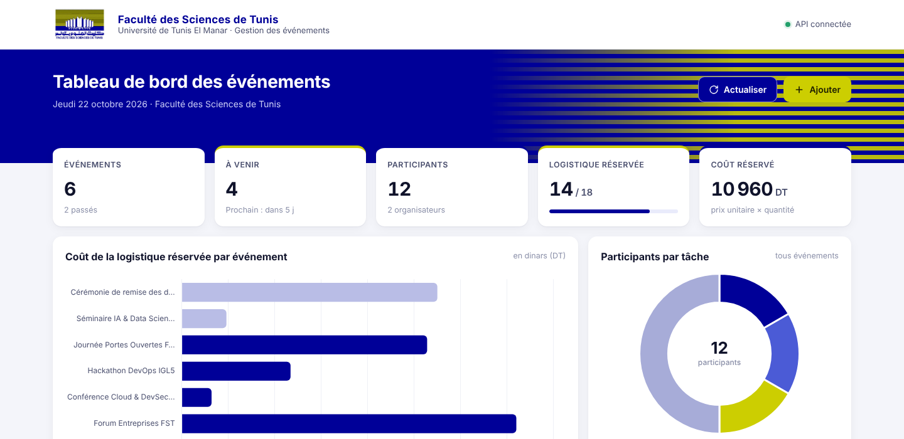
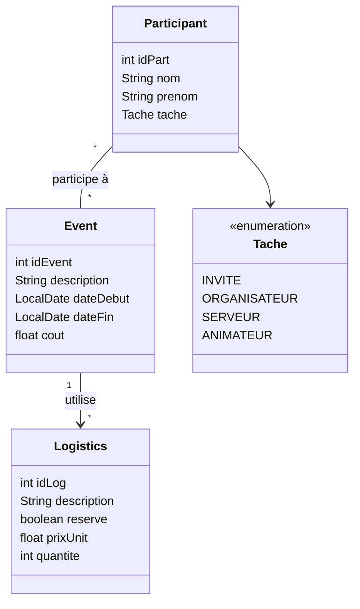

<p align="center">
  
</p>

<h1 align="center">Events Project — Gestion des événements</h1>

<p align="center">
  Application Spring Boot de gestion des événements, des participants et de la logistique<br>
  <b>Faculté des Sciences de Tunis</b> · Université de Tunis El Manar · IGL5 — Groupe 2
</p>

<p align="center">
  
  
  
  
  
</p>

---

## Sommaire

- [Présentation](#présentation)
- [Dashboard](#dashboard)
- [Stack technique](#stack-technique)
- [Architecture](#architecture)
- [Modèle de données](#modèle-de-données)
- [Démarrage rapide](#démarrage-rapide)
- [API REST](#api-rest)
- [Tests et couverture](#tests-et-couverture)
- [Pipeline CI/CD · DevSecOps · GitOps](#pipeline-cicd--devsecops--gitops)
- [Structure du projet](#structure-du-projet)
- [Workflow Git](#workflow-git)
- [Dépannage](#dépannage)

---

## Présentation

**Events Project** permet d'organiser les événements de la faculté (journées portes ouvertes, hackathons, conférences, forums…) :

- **Événements** : création, dates de début et de fin, coût calculé automatiquement.
- **Participants** : gestion CRUD et affectation d'une tâche (`ORGANISATEUR`, `ANIMATEUR`, `SERVEUR`, `INVITE`).
- **Logistique** : matériel et services rattachés à un événement (prix unitaire, quantité, réservé ou non).
- **Statistiques** : par événement et globales (participants par tâche, taux de réservation, coût de la logistique réservée).
- **Dashboard web** aux couleurs de la FST, servi directement par l'application.
- **Tâche planifiée** (`@Scheduled`) qui recalcule régulièrement le coût des événements.
- **Aspect AOP** (`PerformanceAspect`) qui journalise le temps d'exécution de chaque méthode des services.

## Dashboard

Une fois l'application lancée : **<http://localhost:8089/events/>**

<p align="center">
  
</p>

| Zone | Contenu |
|---|---|
| Indicateurs clés | Nombre d'événements (à venir / passés), participants, logistique réservée, coût total réservé |
| Graphiques | Coût de la logistique réservée par événement · participants par tâche · composition des équipes par événement |
| Prochains événements | Frise chronologique avec compte à rebours |
| Tableau des événements | Recherche, filtre par intervalle de dates, durée, statut (à venir / en cours / terminé) |
| Participants et logistique | Listes filtrables, changement de tâche directement dans le tableau |
| Bouton « Ajouter » | Création d'un événement (avec ses participants), d'un participant ou d'une logistique |

> Le dashboard est une page statique (`src/main/resources/static/index.html`) qui consomme l'API REST. Chart.js est embarqué dans le projet, le dashboard fonctionne donc **sans connexion internet**.

**Données de démonstration** : au premier démarrage, si la base est vide, 6 événements, 12 participants et leur logistique sont insérés automatiquement (`DemoDataLoader`). Pour désactiver ce comportement :

```properties
# src/main/resources/application.properties
app.demo-data=false
```

## Stack technique

| Couche | Technologies |
|---|---|
| Langage | Java 8+ (configuré pour les JDK 8 à 26) |
| Framework | Spring Boot 2.7.6 (Web, Data JPA, AOP, Scheduling) |
| Persistance | Hibernate / JPA · MySQL 8 (application) · H2 en mémoire (tests) |
| Productivité | Lombok 1.18.46 |
| Tests | JUnit 4 & 5 · Mockito · MockMvc · Spring Boot Test |
| Qualité | JaCoCo 0.8.15 (couverture de code) |
| Front | HTML / CSS / JavaScript · Chart.js 4.4.1 |
| Build | Maven (wrapper `mvnw` inclus) |

## Architecture

Architecture en couches classique **Controller → Service → Repository → Base de données**.


## Modèle de données



- `Participant` est le **côté propriétaire** de la relation `ManyToMany` avec `Event`.
- `Event → Logistics` est une relation `OneToMany` unidirectionnelle, chargée en `EAGER`.
- Le coût d'un événement = somme de `prixUnit × quantite` des logistiques **réservées**.

## Démarrage rapide

### Prérequis

- **JDK 17** recommandé (le `pom.xml` est configuré pour les JDK 8 à 26)
- **MySQL 8** démarré sur `localhost:3306` (XAMPP, WAMP, Docker… au choix)
- Maven 3.6+ (ou le wrapper `mvnw` fourni)

### 1. Cloner le dépôt

```bash
git clone <url-du-depot>
cd IGL5-G2-EventsProjetcs
```

### 2. Configurer la base de données

La base `eventsProject` est créée automatiquement au démarrage. Par défaut, l'utilisateur est `root` sans mot de passe. Pour modifier, éditez `src/main/resources/application.properties` :

```properties
spring.datasource.url=jdbc:mysql://localhost:3306/eventsProject?createDatabaseIfNotExist=true&serverTimezone=UTC
spring.datasource.username=root
spring.datasource.password=
```

> Pour lancer MySQL rapidement avec Docker :
> ```bash
> docker run -d --name mysql-events -p 3306:3306 -e MYSQL_ALLOW_EMPTY_PASSWORD=yes mysql:8
> ```

### 3. Lancer l'application

```bash
mvn spring-boot:run
# ou, sous Windows : mvnw.cmd spring-boot:run
```

| Ressource | URL |
|---|---|
| Dashboard | <http://localhost:8089/events/> |
| Base de l'API | `http://localhost:8089/events` |

### 4. Construire le JAR

```bash
mvn clean package
java -jar target/eventsProject-1.0.0-SNAPSHOT.jar
```

## API REST

Toutes les routes sont préfixées par le context-path **`/events`** (ex. `http://localhost:8089/events/participant/all`).

### Statistiques — `/event-stats`

| Méthode | Route | Description |
|---|---|---|
| `GET` | `/event-stats` | Statistiques de tous les événements, triées par date |
| `GET` | `/event-stats/summary` | Indicateurs globaux du dashboard |
| `GET` | `/event-stats/{id}` | Statistiques d'un événement (`404` s'il n'existe pas) |
| `GET` | `/event-stats/upcoming` | Statistiques des événements à venir |
| `GET` | `/event-stats/between/{d1}/{d2}` | Événements dont la date de début est entre `d1` et `d2` (`yyyy-MM-dd`, `400` si `d1 > d2`) |

<details>
<summary>Exemple de réponse — <code>GET /event-stats/1</code></summary>

```json
{
  "idEvent": 1,
  "description": "Journée Portes Ouvertes FST",
  "dateDebut": "2026-10-27",
  "dateFin": "2026-10-27",
  "dureeJours": 1,
  "nbParticipants": 6,
  "participantsParTache": { "INVITE": 3, "ORGANISATEUR": 1, "SERVEUR": 1, "ANIMATEUR": 1 },
  "nbLogistics": 4,
  "nbLogisticsReservees": 3,
  "coutLogistiqueReservee": 2640.0
}
```
</details>

<details>
<summary>Exemple de réponse — <code>GET /event-stats/summary</code></summary>

```json
{
  "nbEvents": 6,
  "nbEventsAVenir": 4,
  "nbParticipants": 12,
  "nbLogistics": 18,
  "nbLogisticsReservees": 14,
  "tauxReservation": 77.78,
  "coutTotalLogistiqueReservee": 10960.0,
  "participantsParTache": { "INVITE": 6, "ORGANISATEUR": 2, "SERVEUR": 2, "ANIMATEUR": 2 }
}
```
</details>

### Événements — `/event`

| Méthode | Route | Description |
|---|---|---|
| `POST` | `/event/addPart` | Ajouter un participant |
| `POST` | `/event/addEvent` | Créer un événement et l'affecter aux participants listés dans `participants` |
| `POST` | `/event/addEvent/{id}` | Créer un événement et l'affecter au participant `{id}` |
| `PUT` | `/event/addAffectLog/{description}` | Ajouter une logistique à l'événement portant cette description |
| `GET` | `/event/getLogs/{d1}/{d2}` | Logistiques réservées des événements entre deux dates |

### Participants — `/participant`

| Méthode | Route | Description |
|---|---|---|
| `POST` | `/participant/add` | Créer un participant |
| `GET` | `/participant/all` | Lister tous les participants |
| `GET` | `/participant/{id}` | Détail d'un participant (`404` s'il n'existe pas) |
| `PUT` | `/participant/update/{id}` | Modifier nom, prénom et tâche |
| `PUT` | `/participant/{id}/tache/{tache}` | Changer uniquement la tâche |
| `DELETE` | `/participant/delete/{id}` | Supprimer un participant |

### Logistique — `/logistics`

| Méthode | Route | Description |
|---|---|---|
| `POST` | `/logistics` | Créer une logistique (`201`) |
| `PUT` | `/logistics` | Modifier une logistique |
| `GET` | `/logistics` | Lister toutes les logistiques |
| `GET` | `/logistics/{id}` | Détail d'une logistique |
| `GET` | `/logistics/reserved` | Lister les logistiques réservées |
| `GET` | `/logistics/{id}/cout` | Coût total (`prixUnit × quantite`) |
| `DELETE` | `/logistics/{id}` | Supprimer une logistique (`204`) |

### Exemples `curl`

```bash
# Créer un participant
curl -X POST http://localhost:8089/events/participant/add \
  -H "Content-Type: application/json" \
  -d '{"nom":"Tounsi","prenom":"Ahmed","tache":"ORGANISATEUR"}'

# Créer un événement affecté aux participants 1 et 2
curl -X POST http://localhost:8089/events/event/addEvent \
  -H "Content-Type: application/json" \
  -d '{"description":"Hackathon","dateDebut":"2026-11-05","dateFin":"2026-11-06","participants":[{"idPart":1},{"idPart":2}]}'

# Ajouter une logistique réservée à cet événement
curl -X PUT http://localhost:8089/events/event/addAffectLog/Hackathon \
  -H "Content-Type: application/json" \
  -d '{"description":"Pause-café","reserve":true,"prixUnit":6,"quantite":120}'

# Consulter les statistiques globales
curl http://localhost:8089/events/event-stats/summary
```

## Tests et couverture

Chaque fonctionnalité est testée de deux façons :

| Type | Principe | Base de données |
|---|---|---|
| **Avec Mockito** (`*MockTest`, `*MockitoTest`) | Repositories ou services simulés, test unitaire rapide | Aucune |
| **Sans Mockito** (`*Test`, `*IntegrationTest`) | Contexte Spring complet, vrais services et repositories | H2 en mémoire |

| Fonctionnalité | Tests avec Mockito | Tests sans Mockito |
|---|---|---|
| Événements | `EventServicesMockTest` | `EventServicesImplTest` |
| Participants | `ParticipantServicesImplMockitoTest`, `ParticipantRestControllerMockitoTest` | `ParticipantServicesImplIntegrationTest`, `ParticipantRestControllerIntegrationTest` |
| Logistique | `LogisticsServiceImplMockTest`, `LogisticsControllerMockTest` | `LogisticsServiceImplTest`, `LogisticsControllerTest` |
| Statistiques | `EventStatsServiceImplMockTest`, `EventStatsControllerMockTest` | `EventStatsServiceImplIntegrationTest` |

```bash
# Lancer tous les tests (rapport JaCoCo généré automatiquement)
mvn clean test

# Lancer une seule classe de test
mvn test -Dtest=EventStatsServiceImplMockTest
```

Le rapport de couverture est disponible dans **`target/site/jacoco/index.html`**.

> Les tests utilisent `src/test/resources/application.properties` (H2 en mémoire) : **MySQL n'est pas nécessaire pour lancer les tests**.

## Pipeline CI/CD · DevSecOps · GitOps

Le pipeline est défini dans [`Jenkinsfile`](Jenkinsfile), exécuté par un job Jenkins Multibranch. Il suit le flux **push → Jenkins → Amazon ECR → dépôt plateforme → Argo CD → EKS → supervision**. Jenkins construit, teste et publie; il ne déploie pas directement sur Kubernetes. Il met à jour l'état GitOps du dépôt [IGL5-G2-Events-Platform](https://github.com/roudayn-kouka/IGL5-G2-Events-Platform), puis Argo CD synchronise le cluster.

<p align="center">
  
</p>

### Équipe et environnements

| Membre | Branche | Feature | Environnement Kubernetes |
|---|---|---|---|
| Roudayna Kouka | `feature/event-statistics` | Statistiques et tableau de bord | `events-event-statistics` |
| Roudayna Kouka | `feature/ci-cd-pipeline` | Finalisation CI/CD, DevSecOps et GitOps | `events-ci-cd-pipeline` |
| Farah Baraket | `feature/participant` | Participants | `events-participant` |
| Ahlem Mastouri | `feature/logistics` | Logistique | `events-logistics` |
| Nour Mustapha | `feature/event` | Événements | `events-event` |
| Emna Ouarteni | `feature/feedback` | Avis et notes | `events-feedback` |

`develop` et `release/*` ciblent `events-staging`; `main` cible `events-prod` après approbation. Une Pull Request vers `develop` exécute seulement l'intégration continue.

### Les 17 étapes

Les numéros sont ceux du rapport de projet : l'étape 0 est le déclenchement webhook, les contrôles 4a/4b et 14a/14b sont parallèles, et l'étape 16 est la supervision continue. Les numéros de ligne ci-dessous pointent vers le stage Jenkins ou le bloc `post` qui l'implémente.

| Nº | Stage Jenkins | Outil(s) | Traitement et résultat | Bloquant ? | Jenkinsfile |
|---:|---|---|---|---|---:|
| 0 | Déclenchement (hors stage) | GitHub, Jenkins Multibranch | Le webhook signale un push ou une Pull Request; Jenkins découvre la branche et lance le build. | Déclencheur | — (JCasC plateforme) |
| 1 | `Contexte & garde GitFlow` | Groovy, Git | Vérifie la branche/PR; déduit propriétaire, environnement, version, image et sévérité. | Oui | 46–90 |
| 2 | `Build Maven` | Maven, JDK 17, Lombok | Définit la version propre à la branche et compile. | Oui | 92–98 |
| 3 | `Tests & couverture` | JUnit, Mockito, H2, JaCoCo | Exécute les tests, assemble le JAR testé et publie rapports/couverture. | Oui | 100–113 |
| 4a | `Secrets · Gitleaks` (parallèle) | Gitleaks | Scanne l'historique Git et archive un rapport masqué. | Oui, toutes branches | 115–125 |
| 4b | `Dépendances & IaC · Trivy FS` (parallèle) | Trivy FS | Analyse dépendances et mauvaises configurations; produit `trivy-fs.txt`. | Rapport, non | 127–139 |
| 5 | `Analyse SonarQube` | SonarQube, JaCoCo | Analyse statique du code et de la couverture. | Analyse | 141–154 |
| 6 | `Quality Gate` | SonarQube, webhook | Attend le verdict de la porte qualité. | Oui | 156–163 |
| 7 | `Publication JAR · Nexus` | Maven, Nexus | Publie le JAR validé dans snapshots ou releases; omis pour une PR. | Oui si déployé | 165–180 |
| 8 | `Image Docker` | Docker, JRE 17 Alpine | Emballe le JAR déjà testé en image non-root et étiquetée. | Oui si déployé | 182–195 |
| 9 | `Scan image · Trivy` | Trivy image | Scanne l'image; seules les vulnérabilités critiques corrigibles bloquent en mode strict. | Rapport; strict sur `release/*`/`main` | 197–212 |
| 10 | `Push image · Amazon ECR` | AWS CLI, IAM, ECR | Pousse l'image avec le rôle IAM de l'EC2, sans clé AWS dans Jenkins. | Oui si déployé | 214–226 |
| 11 | `Approbation production` | Jenkins `input` | Attend l'approbation explicite avant la promotion de `main`. | Oui, `main` uniquement | 228–236 |
| 12 | `Promotion GitOps` | Git, dépôt plateforme | Écrit `config.json` et `values.yaml`, puis pousse le tag dans `gitops/envs/<env>/`. | Oui si déployé | 238–281 |
| 13 | `Synchronisation Argo CD` | Argo CD CLI, Helm, EKS | Attend la révision exacte en états `Synced` et `Healthy`. | Oui si déployé | 283–310 |
| 14a | `Smoke tests` (parallèle) | curl, Actuator | Vérifie obligatoirement readiness et Prometheus; les API métier absentes sont signalées sans échec. | Endpoints Actuator oui | 315–338 |
| 14b | `DAST · OWASP ZAP` (parallèle) | OWASP ZAP | Exécute l'analyse passive de l'application en ligne. | Rapport; strict sur `release/*`/`main` | 340–358 |
| 15 | Notification de fin (bloc `post`) | Slack | Publie succès/échec dans `#igl5-g2-ci`. | Non | 362–374 |
| 16 | Supervision continue (hors stage) | Prometheus, Alertmanager, Grafana | Scrape des métriques, déclenche les alertes et affiche le dashboard. | Hors pipeline | — (`gitops/platform/monitoring-config/`) |

Les numéros de ligne correspondent à la version finale de ce [`Jenkinsfile`](Jenkinsfile); les étapes externes 0 et 16 sont configurées dans le dépôt plateforme et le job Multibranch. Schéma du flux : [docs/pipeline-devops.png](docs/pipeline-devops.png).

### Outils et configuration

| Outil | Rôle dans le projet | Fichiers de configuration |
|---|---|---|
| GitHub | Dépôts, branches, Pull Requests, webhook de build | `ansible/roles/github_webhook/tasks/main.yml` (plateforme), `ansible/roles/devops_stack/templates/jenkins-casc.yaml.j2` |
| GitFlow | Règles `feature/*`, `develop`, `release/*`, `main` | `Jenkinsfile`, `gitops/envs/*/config.json` |
| Jenkins | Multibranch, pipeline, JCasC, outils et identifiants | `Jenkinsfile`; `ansible/roles/devops_stack/templates/jenkins-casc.yaml.j2`; `ansible/roles/devops_stack/files/jenkins/` (plateforme) |
| Maven | Compilation, tests et publication du JAR | `pom.xml`, `ci/maven-settings.xml`, `Jenkinsfile` |
| JUnit | Tests Java automatisés | `pom.xml`, `src/test/java/` |
| Mockito | Isolation des tests unitaires | `pom.xml`, classes `*MockTest`/`*MockitoTest` |
| H2 | Base en mémoire des tests d'intégration | `pom.xml`, `src/test/resources/application.properties` |
| JaCoCo | Mesure et rapport de couverture | `pom.xml`, `Jenkinsfile`, `target/site/jacoco/` |
| Gitleaks | Recherche de secrets dans l'historique Git | `Jenkinsfile` |
| Trivy | Scan fichiers/IaC et image | `Jenkinsfile` |
| SonarQube | Analyse statique et Quality Gate | `Jenkinsfile`; `ansible/roles/sonar_config/tasks/main.yml` (plateforme) |
| Nexus | Dépôt de snapshots/releases Maven | `ci/maven-settings.xml`; `ansible/roles/nexus_config/tasks/main.yml` (plateforme) |
| Docker | Image applicative et outils du build Jenkins | `Dockerfile`; `ansible/roles/devops_stack/files/jenkins/Dockerfile` (plateforme) |
| Amazon ECR | Registre des images et scan à la réception | `Jenkinsfile`; `terraform/ecr.tf` (plateforme) |
| Argo CD | Synchronisation GitOps dans EKS | `terraform/argocd.tf`, `terraform/values/argocd.yaml.tftpl`, `gitops/platform/apps/` (plateforme) |
| Helm | Paramétrage des environnements de l'application | `gitops/charts/events-app/` (plateforme) |
| Kubernetes EKS | Hébergement des namespaces et des workloads | `terraform/eks.tf`, chart Helm et applications Argo CD (plateforme) |
| OWASP ZAP | DAST passif après déploiement | `Jenkinsfile` |
| Prometheus | Collecte et règles d'alerte | `gitops/platform/apps/20-monitoring.yaml`, `gitops/platform/monitoring-config/prometheus-rules.yaml` (plateforme) |
| Alertmanager | Routage Slack des alertes | `gitops/platform/apps/20-monitoring.yaml`, `terraform/argocd.tf` (plateforme) |
| Grafana | Dashboard par environnement | `gitops/platform/monitoring-config/grafana-dashboard-configmap.yaml`, `gitops/platform/apps/20-monitoring.yaml` (plateforme) |
| Slack | Notifications Jenkins, déploiements et incidents | JCasC, `gitops/platform/apps/40-events-environments.yaml`, `gitops/platform/apps/20-monitoring.yaml` (plateforme) |
| Terraform | Infrastructure AWS, EKS, ECR, Argo CD et passage Ansible | `terraform/*.tf`, `terraform/values/` (plateforme) |
| Ansible | Configuration de l'EC2 et des intégrations | `ansible/site.yml`, `ansible/roles/` (plateforme) |

### Webhooks et notifications

| Flux | Rôle / étape | Création ou configuration |
|---|---|---|
| GitHub → Jenkins | Déclenchement étape 0; lance ensuite le pipeline de la branche | Création idempotente : plateforme `ansible/roles/github_webhook/tasks/main.yml`; URL et dépôt : `ansible/group_vars/devops/vars.yml`; réception et job : `ansible/roles/devops_stack/templates/jenkins-casc.yaml.j2` |
| SonarQube → Jenkins | Retour Quality Gate à l'étape 6 | Création idempotente vers `http://jenkins:8080/sonarqube-webhook/` : plateforme `ansible/roles/sonar_config/tasks/main.yml`; consommation : `Jenkinsfile` (stage Quality Gate) |
| Jenkins → Slack | Résultat de build à l'étape 15, canal `#igl5-g2-ci` | `Jenkinsfile` (`notifyTeam`); credential `slack-token` et canal JCasC : plateforme `ansible/roles/devops_stack/templates/jenkins-casc.yaml.j2` |
| Argo CD → Slack | Événements de déploiement après l'étape 13 et suivi de santé | Service/token : plateforme `terraform/values/argocd.yaml.tftpl`; abonnements : `gitops/platform/apps/40-events-environments.yaml` |
| Alertmanager → Slack | Alertes/résolutions de supervision continue, étape 16, canal `#igl5-g2-alertes` | Secret webhook : plateforme `terraform/argocd.tf`; receiver : `gitops/platform/apps/20-monitoring.yaml` |

Les deux premiers sont des webhooks entrants vers Jenkins; Jenkins et Argo CD utilisent l'intégration Slack et Alertmanager un webhook Slack sortant.

### Tests et couverture

Chemins relatifs à `src/test/java/tn/fst/eventsproject/`. Chaque classe et son nombre de tests (résultat de `mvnw -B clean verify`) :

| Classe et chemin | Type | Ce qui est vérifié | Tests |
|---|---|---|---:|
| `controllers/EventStatsControllerMockTest.java` | Unitaire, Mockito | Réponses du contrôleur pour les statistiques d'événement, plages de dates et statistiques globales. | 5 |
| `controllers/LogisticsControllerMockTest.java` | Unitaire, Mockito | Routes CRUD logistique avec service simulé. | 4 |
| `controllers/LogisticsControllerTest.java` | Intégration Spring/H2 | Requêtes HTTP CRUD du contrôleur logistique. | 4 |
| `controllers/ParticipantRestControllerIntegrationTest.java` | Intégration Spring/H2 | CRUD participants, changement de tâche et réponses 404. | 6 |
| `controllers/ParticipantRestControllerMockitoTest.java` | Unitaire Mockito (Web MVC) | Sérialisation JSON, CRUD, tâche invalide et erreurs 404. | 8 |
| `services/EventServicesImplTest.java` | Intégration Spring/H2 | CRUD des événements avec le contexte Spring. | 4 |
| `services/EventServicesMockTest.java` | Unitaire, Mockito | CRUD événements et cas d'identifiant absent. | 5 |
| `services/EventStatsServiceImplIntegrationTest.java` | Intégration Spring/H2 | Calcul des statistiques événementielles et globales persistées. | 4 |
| `services/EventStatsServiceImplMockTest.java` | Unitaire, Mockito | Statistiques, cas vides/inconnus, tri et intervalle de dates invalide. | 9 |
| `services/LogisticsServiceImplMockTest.java` | Unitaire, Mockito | CRUD du service logistique avec repository simulé. | 4 |
| `services/LogisticsServiceImplTest.java` | Intégration Spring/H2 | CRUD logistique avec repositories réels en mémoire. | 4 |
| `services/ParticipantServicesImplIntegrationTest.java` | Intégration Spring/H2 | Persistance CRUD, changement de tâche et participant absent. | 7 |
| `services/ParticipantServicesImplMockitoTest.java` | Unitaire, Mockito | CRUD participants, sauvegarde, tâches et erreurs 404. | 9 |

Commande complète : `./mvnw -B clean verify` (73 tests, H2 pour l'intégration). Couverture HTML : `target/site/jacoco/index.html`; XML : `target/site/jacoco/jacoco.xml`.

### Lancer le pipeline sur sa feature

Depuis le dépôt applicatif, après avoir récupéré la branche `develop` à jour :

```bash
git switch develop
git pull --ff-only origin develop
git switch -c feature/ma-feature
./mvnw -B clean verify
git add . && git commit -m "feat: description de la feature" && git push -u origin feature/ma-feature
```

Le guide de mise en place complet, y compris le backend Terraform, les secrets et le cycle de vie AWS, est dans le dépôt plateforme : [docs/GUIDE-EXECUTION.md](https://github.com/roudayn-kouka/IGL5-G2-Events-Platform/blob/main/docs/GUIDE-EXECUTION.md).

## Structure du projet

```
IGL5-G2-EventsProjetcs
├── pom.xml
├── Jenkinsfile                             # pipeline CI/CD unique
├── Dockerfile
├── ci/maven-settings.xml
├── docs/
│   ├── dashboard.png
│   ├── architecture.png
│   ├── pipeline-devops.png
│   └── Rapport-DevOps-Events-FST-v4.pdf
└── src
    ├── main
    │   ├── java/tn/fst/eventsproject
    │   │   ├── EventsProjectApplication.java   # point d'entrée (@EnableScheduling)
    │   │   ├── config/
    │   │   │   ├── PerformanceAspect.java      # AOP : temps d'exécution des services
    │   │   │   ├── BusinessMetricsConfig.java  # métriques métier pour Prometheus
    │   │   │   └── DemoDataLoader.java         # données de démo (app.demo-data=true)
    │   │   ├── controllers/                    # API REST
    │   │   ├── dto/                            # EventStatsDTO, GlobalStatsDTO
    │   │   ├── entities/                       # Event, Participant, Logistics, Tache
    │   │   ├── repositories/                   # Spring Data JPA
    │   │   └── services/                       # interfaces + implémentations
    │   └── resources
    │       ├── application.properties          # MySQL, port 8089, context-path /events
    │       └── static/                         # dashboard (index.html, logo, Chart.js)
    └── test
        ├── java/tn/fst/eventsproject
        │   ├── controllers/
        │   └── services/
        └── resources/application.properties    # H2 en mémoire pour les tests
```

## Workflow Git

- `main` : branche stable; `develop` : intégration continue.
- `feature/<nom>` : une branche par fonctionnalité (ex. `feature/event-statistics`), fusionnée dans `develop` via une Pull Request.
- `release/<version>` : validation de version avant fusion dans `main`; `hotfix/<nom>` : correctif urgent destiné à `main`.

```bash
git checkout develop && git pull --ff-only origin develop
git checkout -b feature/ma-fonctionnalite
# ... développement + tests ...
./mvnw -B clean verify
git add -A
git commit -m "feat: description de la fonctionnalité"
git push -u origin feature/ma-fonctionnalite
# puis ouvrir une Pull Request vers develop
```

Convention des messages de commit : `feat:` (nouvelle fonctionnalité), `fix:` (correction), `test:` (tests), `docs:` (documentation), `refactor:` (restructuration).

## Dépannage

<details>
<summary><b><code>cannot find symbol: variable log</code> / <code>getXxx()</code> / <code>builder()</code> à la compilation</b></summary>

Lombok n'est pas exécuté. Le `pom.xml` déclare Lombok dans `annotationProcessorPaths` (obligatoire depuis le JDK 23) : vérifiez que vous utilisez bien la version à jour du `pom.xml`. Dans IntelliJ IDEA : *Settings → Build → Compiler → Annotation Processors → Enable annotation processing*, puis *Maven → Reload project*.
</details>

<details>
<summary><b><code>Communications link failure</code> au démarrage</b></summary>

MySQL n'est pas démarré ou n'écoute pas sur le port `3306`. Démarrez MySQL, ou vérifiez l'URL et les identifiants dans `application.properties`.
</details>

<details>
<summary><b>Le dashboard affiche « API injoignable »</b></summary>

L'application n'est pas lancée, ou le dashboard a été ouvert directement comme fichier. Ouvrez-le via le serveur : <http://localhost:8089/events/>.
</details>

<details>
<summary><b><code>Port 8089 was already in use</code></b></summary>

Une autre instance tourne déjà. Arrêtez-la, ou changez `server.port` dans `application.properties`.
</details>

---

<p align="center">
  <sub>Faculté des Sciences de Tunis · Université de Tunis El Manar · IGL5 — Groupe 2</sub>
</p>
