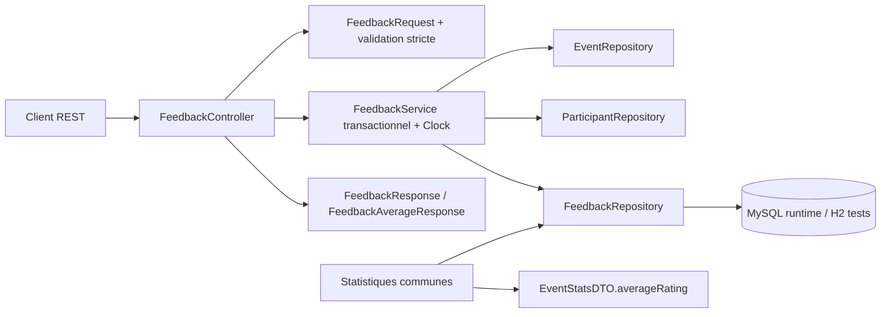
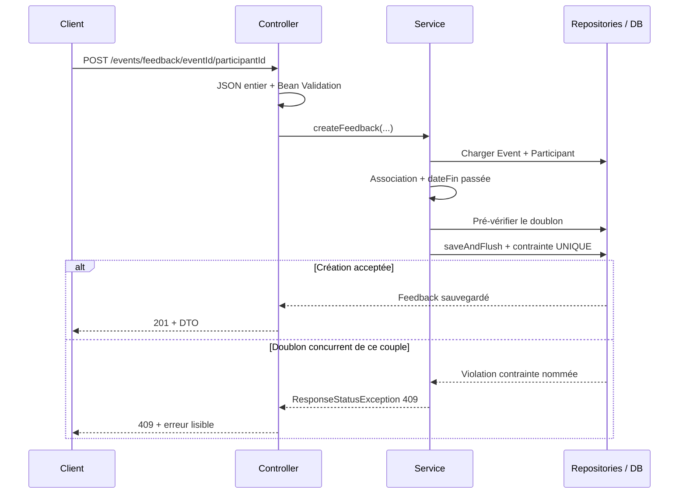
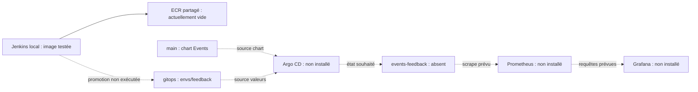

# Dossier de preuves — soutenance individuelle Feedback et CI/CD

**Projet :** `C:\IGL5-G2-EventsProjetcs` · **branche examinée :** `feature/feedback` · **HEAD applicatif :** `a8ba9d6`.
**Date du relevé :** 29 octobre 2026, fuseau `Africa/Tunis` (UTC+1). Le relevé AWS/Kubernetes principal commence à **21:30:30 +01:00** ; il décrit un instant, pas une garantie de disponibilité future. Sources : journal Git reproduit en §13 et observations brutes en §16.

**Périmètre :** implémentation Feedback et exécution du pipeline commun sur cette branche. Event et Participant ne sont étudiés que pour l’éligibilité d’un avis ; les statistiques ne sont étudiées que pour l’intégration de sa moyenne. Les autres fonctionnalités de l’équipe ne sont pas évaluées. Le pipeline et la plateforme sont des composants communs : leur présence ne prouve pas une réalisation individuelle intégrale. [FeedbackController.java:15](../src/main/java/tn/fst/eventsproject/controllers/FeedbackController.java#L15) [FeedbackService.java:50](../src/main/java/tn/fst/eventsproject/services/FeedbackService.java#L50) [EventStatsServiceImpl.java:142](../src/main/java/tn/fst/eventsproject/services/EventStatsServiceImpl.java#L142) [Jenkinsfile:456](../Jenkinsfile#L456)

**Méthode :** lecture du code et de l’historique, rapports Surefire/JaCoCo existants, journaux des builds Feedback #9–#11, métadonnées d’artefacts Nexus, versions des outils de l’agent, lectures AWS et GET Kubernetes. Aucun test applicatif, build Jenkins, scan, plan/apply/destroy Terraform, déploiement ou changement de configuration n’a été lancé pendant cette collecte. Aucun magasin d’identifiants n’a été lu. Seul ce rapport a été créé.

## 1. Synthèse à défendre : ce qui fonctionne réellement

| Élément | Qualification | Preuve |
|---|---|---|
| API Feedback, règles métier, DTO, persistance, concurrence | **Implémenté et testé avec succès**, en environnement de test H2 | 52 cas Feedback ; rapports détaillés §4 ; `feedback-build.log:11176` |
| Build et tests sur Jenkins | **Exécutés avec succès sur la branche**, au sein d’un build globalement en échec | J11:L668 : 125 tests, zéro échec/erreur/ignoré ; J11:L681 : BUILD SUCCESS Maven |
| Analyse SonarQube et Quality Gate | **Exécutés avec succès** sur #11 | J11:L1012 : ANALYSIS SUCCESSFUL ; J11:L1035 : gate OK |
| Valeurs chiffrées SonarQube : couverture, bugs, vulnérabilités, dette, duplication | **Non vérifiées** | API measures HTTP 401 au relevé ; ne pas substituer JaCoCo à Sonar (§7, §16) |
| Publication Nexus SNAPSHOT | **Exécutée et artefact retrouvé** | J11:L1092–1095 et métadonnée NEXUS-JAR:L3/L10 (§8, §16) |
| Publication RELEASE pour Feedback | **Non démontrée** ; branche Feedback produit un SNAPSHOT | [Jenkinsfile:67](../Jenkinsfile#L67) [Jenkinsfile:170](../Jenkinsfile#L170) |
| Image Docker | **Construite avec succès** en #11 | J11:L1165 : tag `registry.local/events-app:feedback-11-a8ba9d6` |
| Gitleaks | **Exécuté sans fuite détectée** dans le périmètre du scan #11 | J11:L744 ; rapport JSON de l’agent : tableau vide |
| Trivy | **Exécuté, mais résultat non vierge** | J11:L1189/L1194 : une CRITICAL dans l’image ; IaC également signalé (§9) |
| Push Amazon ECR #11 | **Échec démontré** | J11:L1205 : `aws: not found` ; région et registre absents de la commande de ce build |
| Nouveau stage ECR avec Secret file Academy | **Implémenté localement ; exécution Jenkins non démontrée** | [Jenkinsfile:215](../Jenkinsfile#L215) ; modification non commitée au relevé |
| Infrastructure EKS/ECR/S3 | **Existence et état vérifiés par lectures AWS** | EKS ACTIVE 1.34, node group ACTIVE, dépôt existant, S3 versionné/chiffré (§10, §16) |
| Application `events-feedback`, Argo CD, monitoring | **Absents au relevé Kubernetes**, malgré leur configuration dans Git | GET des trois namespaces : HTTP 404 ; liste des pods Feedback vide (§16) |
| Image dans ECR | **Aucune au relevé** | `list-images` : `imageIds=[]` (§16) |
| Pipeline complet vert et déploiement Feedback EKS | **Non démontrés** | builds historiques #9–#11 FAILURE ; #11 s’arrête avant GitOps (§6, §16) |

**Formulation orale défendable :** « J’ai implémenté et testé la fonctionnalité Feedback. Sur ma branche, j’ai démontré la chaîne jusqu’à la construction et au scan de l’image, avec Quality Gate OK et publication SNAPSHOT. J’ai corrigé la préparation de l’accès AWS ; l’infrastructure existe, mais le push ECR corrigé et le déploiement applicatif restent à démontrer. » Les limites de cette formulation sont établies par les preuves ci-dessus.

## 2. Besoin fonctionnel, règles et contrat REST

Un participant déjà associé à un événement terminé peut déposer une note entière de 1 à 5, avec un commentaire facultatif. Un seul avis est autorisé pour le couple événement/participant. L’application peut lister les avis, retourner leur moyenne et supprimer un avis. [FeedbackService.java:46](../src/main/java/tn/fst/eventsproject/services/FeedbackService.java#L46) [FeedbackService.java:54](../src/main/java/tn/fst/eventsproject/services/FeedbackService.java#L54) [FeedbackService.java:59](../src/main/java/tn/fst/eventsproject/services/FeedbackService.java#L59) [FeedbackService.java:62](../src/main/java/tn/fst/eventsproject/services/FeedbackService.java#L62) [FeedbackController.java:21](../src/main/java/tn/fst/eventsproject/controllers/FeedbackController.java#L21) [FeedbackController.java:29](../src/main/java/tn/fst/eventsproject/controllers/FeedbackController.java#L29) [FeedbackController.java:35](../src/main/java/tn/fst/eventsproject/controllers/FeedbackController.java#L35) [FeedbackController.java:40](../src/main/java/tn/fst/eventsproject/controllers/FeedbackController.java#L40)

### 2.1 Les quatre endpoints Feedback

Préfixe réel : `/events` ; port applicatif configuré : **8089**. Les routes du contrôleur sont préfixées par `/feedback`. Les exemples ci-dessous illustrent le contrat ; ils ne constituent pas de nouvelles requêtes exécutées pendant ce relevé. [application.properties:3](../src/main/resources/application.properties#L3) [application.properties:4](../src/main/resources/application.properties#L4) [FeedbackController.java:16](../src/main/java/tn/fst/eventsproject/controllers/FeedbackController.java#L16)

| Méthode et URI complète | Entrée / résultat nominal | Erreurs métier ou de validation | Sources |
|---|---|---|---|
| `POST /events/feedback/{idEvent}/{idPart}` | JSON `{"note":5,"commentaire":"Excellent"}` ; **201**, `FeedbackResponse` | **400** note invalide, non-association, événement non terminé ; **404** événement/participant absent ; **409** doublon | [FeedbackController.java:21](../src/main/java/tn/fst/eventsproject/controllers/FeedbackController.java#L21) [FeedbackRequest.java:14](../src/main/java/tn/fst/eventsproject/dto/FeedbackRequest.java#L14) [FeedbackService.java:46](../src/main/java/tn/fst/eventsproject/services/FeedbackService.java#L46) |
| `GET /events/feedback/event/{id}` | **200**, liste de DTO ; liste vide si aucun avis | **404** événement absent | [FeedbackController.java:29](../src/main/java/tn/fst/eventsproject/controllers/FeedbackController.java#L29) [FeedbackService.java:88](../src/main/java/tn/fst/eventsproject/services/FeedbackService.java#L88) |
| `GET /events/feedback/event/{id}/moyenne` | **200**, `{"eventId":1,"averageRating":4.5,"totalFeedbacks":2}` | **404** événement absent | [FeedbackController.java:35](../src/main/java/tn/fst/eventsproject/controllers/FeedbackController.java#L35) [FeedbackService.java:93](../src/main/java/tn/fst/eventsproject/services/FeedbackService.java#L93) [FeedbackAverageResponse.java:8](../src/main/java/tn/fst/eventsproject/dto/FeedbackAverageResponse.java#L8) |
| `DELETE /events/feedback/{id}` | **204**, corps vide | **404** avis absent | [FeedbackController.java:40](../src/main/java/tn/fst/eventsproject/controllers/FeedbackController.java#L40) [FeedbackService.java:99](../src/main/java/tn/fst/eventsproject/services/FeedbackService.java#L99) |

Une erreur de syntaxe JSON ou un identifiant non numérique donne **400**, avec un corps contenant `status`, `error`, `message`. Le conseil d’exception est limité à `FeedbackController`, pas à toutes les API du projet. [FeedbackExceptionHandler.java:16](../src/main/java/tn/fst/eventsproject/controllers/FeedbackExceptionHandler.java#L16) [FeedbackExceptionHandler.java:23](../src/main/java/tn/fst/eventsproject/controllers/FeedbackExceptionHandler.java#L23) [FeedbackExceptionHandler.java:31](../src/main/java/tn/fst/eventsproject/controllers/FeedbackExceptionHandler.java#L31) [FeedbackExceptionHandler.java:36](../src/main/java/tn/fst/eventsproject/controllers/FeedbackExceptionHandler.java#L36)

### 2.2 Règles importantes à expliquer dans le code

1. **Validation stricte de la note :** `Integer`, `@NotNull`, `@Min(1)`, `@Max(5)`, `@Valid`. Le désérialiseur n’accepte que le jeton JSON `VALUE_NUMBER_INT` : `5.0`, `1.5`, `"5"`, `true`, dépassement d’entier, valeur nulle ou absente sont refusés. Le service revalide la plage pour les appels non HTTP. [FeedbackRequest.java:14](../src/main/java/tn/fst/eventsproject/dto/FeedbackRequest.java#L14) [FeedbackRatingDeserializer.java:13](../src/main/java/tn/fst/eventsproject/dto/FeedbackRatingDeserializer.java#L13) [FeedbackController.java:24](../src/main/java/tn/fst/eventsproject/controllers/FeedbackController.java#L24) [FeedbackService.java:47](../src/main/java/tn/fst/eventsproject/services/FeedbackService.java#L47) [FeedbackControllerIntegrationTest.java:90](../src/test/java/tn/fst/eventsproject/controllers/FeedbackControllerIntegrationTest.java#L90)
2. **Éligibilité :** chargement d’Event et Participant par les repositories existants ; recherche de l’événement dans `Participant.events`, côté propriétaire de la relation ManyToMany. Il ne s’agit pas d’une vérification d’identité de l’utilisateur connecté. [FeedbackService.java:50](../src/main/java/tn/fst/eventsproject/services/FeedbackService.java#L50) [FeedbackService.java:54](../src/main/java/tn/fst/eventsproject/services/FeedbackService.java#L54) [Participant.java:26](../src/main/java/tn/fst/eventsproject/entities/Participant.java#L26)
3. **Fin inclusive :** `dateFin` est une `LocalDate`, pas un instant de fin. L’avis est autorisé uniquement si elle est strictement antérieure à aujourd’hui ; un événement finissant aujourd’hui est encore considéré non terminé. Une date inconnue est refusée. Le `Clock` de production utilise le fuseau par défaut du serveur ; un test fige le fuseau `Africa/Tunis`. Ne pas affirmer que la production force déjà ce fuseau. [Event.java:23](../src/main/java/tn/fst/eventsproject/entities/Event.java#L23) [FeedbackService.java:34](../src/main/java/tn/fst/eventsproject/services/FeedbackService.java#L34) [FeedbackService.java:58](../src/main/java/tn/fst/eventsproject/services/FeedbackService.java#L58) [FeedbackServiceTest.java:219](../src/test/java/tn/fst/eventsproject/services/FeedbackServiceTest.java#L219)
4. **Date d’avis côté serveur :** `clock.instant()` est affecté dans le service ; `@PrePersist` fournit un filet de sécurité si la date est absente. Le DTO d’entrée n’expose pas `date`. Le test HTTP vérifie qu’une date proposée par le client ne remplace pas l’horodatage serveur. [FeedbackService.java:70](../src/main/java/tn/fst/eventsproject/services/FeedbackService.java#L70) [Feedback.java:27](../src/main/java/tn/fst/eventsproject/entities/Feedback.java#L27) [Feedback.java:38](../src/main/java/tn/fst/eventsproject/entities/Feedback.java#L38) [FeedbackRequest.java:13](../src/main/java/tn/fst/eventsproject/dto/FeedbackRequest.java#L13) [FeedbackControllerIntegrationTest.java:62](../src/test/java/tn/fst/eventsproject/controllers/FeedbackControllerIntegrationTest.java#L62)
5. **Doublons et concurrence :** pré-vérification lisible, puis contrainte SQL unique nommée `uk_feedback_event_participant`. `saveAndFlush` force le contrôle avant la sortie du service transactionnel. Seule la violation de cette contrainte est traduite en **409** ; les autres erreurs d’intégrité ne sont pas maquillées en doublons. [Feedback.java:11](../src/main/java/tn/fst/eventsproject/entities/Feedback.java#L11) [FeedbackService.java:62](../src/main/java/tn/fst/eventsproject/services/FeedbackService.java#L62) [FeedbackService.java:71](../src/main/java/tn/fst/eventsproject/services/FeedbackService.java#L71) [FeedbackService.java:112](../src/main/java/tn/fst/eventsproject/services/FeedbackService.java#L112) [FeedbackServiceTest.java:159](../src/test/java/tn/fst/eventsproject/services/FeedbackServiceTest.java#L159) [FeedbackServiceTest.java:168](../src/test/java/tn/fst/eventsproject/services/FeedbackServiceTest.java#L168)
6. **Consultation :** tri par date puis identifiant pour un ordre déterministe ; moyenne calculée en base par JPQL `coalesce(avg(f.note), 0.0)`. Un événement existant sans avis donne une moyenne **0.0**, un compteur **0** et une liste vide ; un événement inexistant donne **404**. [FeedbackRepository.java:11](../src/main/java/tn/fst/eventsproject/repositories/FeedbackRepository.java#L11) [FeedbackRepository.java:17](../src/main/java/tn/fst/eventsproject/repositories/FeedbackRepository.java#L17) [FeedbackService.java:88](../src/main/java/tn/fst/eventsproject/services/FeedbackService.java#L88) [FeedbackService.java:106](../src/main/java/tn/fst/eventsproject/services/FeedbackService.java#L106) [FeedbackControllerIntegrationTest.java:139](../src/test/java/tn/fst/eventsproject/controllers/FeedbackControllerIntegrationTest.java#L139)

### 2.3 Limites fonctionnelles à reconnaître

- Pas de `PUT`/`PATCH`, ni d’endpoint Feedback « liste par participant » dans ce contrôleur. Pas de preuve d’une interface de saisie d’avis : l’intégration UI repérée affiche la moyenne. [FeedbackController.java:18](../src/main/java/tn/fst/eventsproject/controllers/FeedbackController.java#L18) [index.html:569](../src/main/resources/static/index.html#L569)
- Pas de système d’authentification/autorisation pour ces routes : l’identifiant participant fourni dans l’URL n’est pas lié à une identité authentifiée ; la suppression n’a pas de contrôle de propriétaire. C’est une limite connue, pas une API sécurisée par JWT. [feedback.md:45](../docs/feedback.md#L45) [FeedbackController.java:23](../src/main/java/tn/fst/eventsproject/controllers/FeedbackController.java#L23) [FeedbackController.java:42](../src/main/java/tn/fst/eventsproject/controllers/FeedbackController.java#L42)
- Le commentaire est facultatif et stocké en LOB ; pas de borne de longueur explicite dans `FeedbackRequest`. La note n’a pas de contrainte SQL de plage visible dans l’entité : cette règle est portée par DTO/service ; la base impose notamment le non-null et l’unicité. [FeedbackRequest.java:20](../src/main/java/tn/fst/eventsproject/dto/FeedbackRequest.java#L20) [Feedback.java:21](../src/main/java/tn/fst/eventsproject/entities/Feedback.java#L21) [Feedback.java:24](../src/main/java/tn/fst/eventsproject/entities/Feedback.java#L24)
- H2 démontre les tests d’intégration, pas une certification du comportement concurrent de MySQL en production. Le modèle utilise `ddl-auto=update`, sans migration SQL Feedback versionnée repérée dans les fichiers source examinés. [application.properties:2](../src/test/resources/application.properties#L2) [application.properties:12](../src/main/resources/application.properties#L12)

## 3. Architecture exacte et compréhension du code

| Couche | Fichier et responsabilité | Dépendances utiles à Feedback |
|---|---|---|
| REST | [FeedbackController.java:18](../src/main/java/tn/fst/eventsproject/controllers/FeedbackController.java#L18) : `create`, `getByEvent`, `average`, `delete`, mapping DTO | injection par constructeur via Lombok, `FeedbackService` |
| Erreurs HTTP | [FeedbackExceptionHandler.java:16](../src/main/java/tn/fst/eventsproject/controllers/FeedbackExceptionHandler.java#L16) : traduction homogène des erreurs métier, Bean Validation et JSON | conseil limité au contrôleur Feedback |
| Métier | [FeedbackService.java:23](../src/main/java/tn/fst/eventsproject/services/FeedbackService.java#L23) : validation, éligibilité, fin, date, doublons, consultation, suppression | trois repositories, `Clock` injectable ; constructeur Spring et constructeur de test |
| Persistence | [FeedbackRepository.java:10](../src/main/java/tn/fst/eventsproject/repositories/FeedbackRepository.java#L10) : `JpaRepository<Feedback,Integer>`, méthodes dérivées, agrégat JPQL | Event/Participant référencés par leur identifiant |
| Entité | [Feedback.java:10](../src/main/java/tn/fst/eventsproject/entities/Feedback.java#L10) : ID auto-incrémenté, note, commentaire, date, relations LAZY obligatoires | ManyToOne vers Event et Participant, contrainte de couple unique |
| Entrée REST | [FeedbackRequest.java:13](../src/main/java/tn/fst/eventsproject/dto/FeedbackRequest.java#L13) : `FeedbackRequest` | uniquement note/commentaire, validation et désérialisation stricte |
| Sortie REST | [FeedbackResponse.java:11](../src/main/java/tn/fst/eventsproject/dto/FeedbackResponse.java#L11) : `FeedbackResponse.from` | ID, note, commentaire, date, `eventId`, `participantId` ; aucune collection JPA |
| Moyenne | [FeedbackAverageResponse.java:8](../src/main/java/tn/fst/eventsproject/dto/FeedbackAverageResponse.java#L8) : `FeedbackAverageResponse` | `eventId`, `averageRating`, `totalFeedbacks` |
| Intégration commune | [EventStatsServiceImpl.java:142](../src/main/java/tn/fst/eventsproject/services/EventStatsServiceImpl.java#L142) et [EventStatsDTO.java:47](../src/main/java/tn/fst/eventsproject/dto/EventStatsDTO.java#L47) | la moyenne Feedback est ajoutée au DTO statistique existant ; pas une réécriture de la feature statistiques |
| UI commune | [index.html:569](../src/main/resources/static/index.html#L569) | moyenne formatée `/ 5`, ou « Aucun avis » |



Ce diagramme décrit le code, pas une topologie déployée : [FeedbackController.java:19](../src/main/java/tn/fst/eventsproject/controllers/FeedbackController.java#L19) [FeedbackService.java:26](../src/main/java/tn/fst/eventsproject/services/FeedbackService.java#L26) [FeedbackService.java:31](../src/main/java/tn/fst/eventsproject/services/FeedbackService.java#L31) [FeedbackRepository.java:10](../src/main/java/tn/fst/eventsproject/repositories/FeedbackRepository.java#L10) [EventStatsServiceImpl.java:142](../src/main/java/tn/fst/eventsproject/services/EventStatsServiceImpl.java#L142) [application.properties:7](../src/main/resources/application.properties#L7) [application.properties:2](../src/test/resources/application.properties#L2).



Sources de la séquence : [FeedbackController.java:21](../src/main/java/tn/fst/eventsproject/controllers/FeedbackController.java#L21) [FeedbackService.java:46](../src/main/java/tn/fst/eventsproject/services/FeedbackService.java#L46) [FeedbackService.java:71](../src/main/java/tn/fst/eventsproject/services/FeedbackService.java#L71) [FeedbackExceptionHandler.java:18](../src/main/java/tn/fst/eventsproject/controllers/FeedbackExceptionHandler.java#L18). Le traitement HTTP n’est pas un mécanisme de verrouillage distribué : c’est la contrainte SQL qui ferme la course concurrente. [Feedback.java:11](../src/main/java/tn/fst/eventsproject/entities/Feedback.java#L11) [FeedbackConcurrencyIntegrationTest.java:63](../src/test/java/tn/fst/eventsproject/controllers/FeedbackConcurrencyIntegrationTest.java#L63)

## 4. Tests JUnit : méthodes réelles et portée

**52 exécutions Feedback = 24 service + 6 repository + 21 HTTP + 1 concurrence.** Il s’agit d’exécutions incluant les paramètres, pas de 52 méthodes Java distinctes. Les rapports Surefire locaux donnent zéro échec/erreur/ignoré ; le build #11 donne 125 cas au niveau projet. Les 73 autres cas ne sont pas présentés comme un travail Feedback. Sources : rapports ci-dessous ; J11:L668 ; [feedback.md:77](../docs/feedback.md#L77).

| Classe | Type réel | Mockito ? | Preuve de résultat |
|---|---|---|---|
| `FeedbackServiceTest` | tests unitaires métier ; repositories simulés ; Clock fixe | **Oui** : JUnit 5 + `MockitoExtension`, `@Mock`, `when`, `verify` | [FeedbackServiceTest.java:29](../src/test/java/tn/fst/eventsproject/services/FeedbackServiceTest.java#L29) ; `target/surefire-reports/tn.fst.eventsproject.services.FeedbackServiceTest.txt:4` : 24 réussis |
| `FeedbackRepositoryTest` | tranche JPA avec EntityManager/H2 et vraies contraintes | **Non** | [FeedbackRepositoryTest.java:16](../src/test/java/tn/fst/eventsproject/repositories/FeedbackRepositoryTest.java#L16) ; `target/surefire-reports/tn.fst.eventsproject.repositories.FeedbackRepositoryTest.txt:4` : 6 réussis |
| `FeedbackControllerIntegrationTest` | contexte Spring complet, vrai service/repository/H2, MockMvc | **Non** : MockMvc n’est pas un mock Mockito | [FeedbackControllerIntegrationTest.java:29](../src/test/java/tn/fst/eventsproject/controllers/FeedbackControllerIntegrationTest.java#L29) ; `target/surefire-reports/tn.fst.eventsproject.controllers.FeedbackControllerIntegrationTest.txt:4` : 21 réussis |
| `FeedbackConcurrencyIntegrationTest` | deux requêtes concurrentes, transactions réelles et lecture après commit | **Non** | [FeedbackConcurrencyIntegrationTest.java:25](../src/test/java/tn/fst/eventsproject/controllers/FeedbackConcurrencyIntegrationTest.java#L25) ; `target/surefire-reports/tn.fst.eventsproject.controllers.FeedbackConcurrencyIntegrationTest.txt:4` : 1 réussi |

#### FeedbackServiceTest ? 24 cas passes

| Methode Java exacte | Cas executes dans le XML | Source |
|---|---:|---|
| `createsWithServerTimestamp` | 1 | [FeedbackServiceTest.java:60](../src/test/java/tn/fst/eventsproject/services/FeedbackServiceTest.java#L60) |
| `rejectsInvalidRating` | 4 | [FeedbackServiceTest.java:74](../src/test/java/tn/fst/eventsproject/services/FeedbackServiceTest.java#L74) |
| `rejectsMissingEvent` | 1 | [FeedbackServiceTest.java:80](../src/test/java/tn/fst/eventsproject/services/FeedbackServiceTest.java#L80) |
| `rejectsMissingParticipant` | 1 | [FeedbackServiceTest.java:85](../src/test/java/tn/fst/eventsproject/services/FeedbackServiceTest.java#L85) |
| `rejectsUnassociatedParticipant` | 1 | [FeedbackServiceTest.java:91](../src/test/java/tn/fst/eventsproject/services/FeedbackServiceTest.java#L91) |
| `rejectsEventsEndingTodayOrLater` | 2 | [FeedbackServiceTest.java:99](../src/test/java/tn/fst/eventsproject/services/FeedbackServiceTest.java#L99) |
| `rejectsUnknownEndDate` | 1 | [FeedbackServiceTest.java:106](../src/test/java/tn/fst/eventsproject/services/FeedbackServiceTest.java#L106) |
| `rejectsDuplicate` | 1 | [FeedbackServiceTest.java:113](../src/test/java/tn/fst/eventsproject/services/FeedbackServiceTest.java#L113) |
| `deletesExistingFeedback` | 1 | [FeedbackServiceTest.java:121](../src/test/java/tn/fst/eventsproject/services/FeedbackServiceTest.java#L121) |
| `rejectsDeletingMissingFeedback` | 1 | [FeedbackServiceTest.java:129](../src/test/java/tn/fst/eventsproject/services/FeedbackServiceTest.java#L129) |
| `retrievesFeedbackAndAverage` | 1 | [FeedbackServiceTest.java:134](../src/test/java/tn/fst/eventsproject/services/FeedbackServiceTest.java#L134) |
| `emptyEventHasEmptyListAndZeroAverage` | 1 | [FeedbackServiceTest.java:146](../src/test/java/tn/fst/eventsproject/services/FeedbackServiceTest.java#L146) |
| `readsRejectMissingEvent` | 1 | [FeedbackServiceTest.java:154](../src/test/java/tn/fst/eventsproject/services/FeedbackServiceTest.java#L154) |
| `translatesConcurrentDatabaseDuplicateIntoConflict` | 1 | [FeedbackServiceTest.java:160](../src/test/java/tn/fst/eventsproject/services/FeedbackServiceTest.java#L160) |
| `doesNotMislabelOtherDatabaseErrorsAsDuplicates` | 1 | [FeedbackServiceTest.java:169](../src/test/java/tn/fst/eventsproject/services/FeedbackServiceTest.java#L169) |
| `doesNotMislabelUnknownDatabaseErrors` | 1 | [FeedbackServiceTest.java:179](../src/test/java/tn/fst/eventsproject/services/FeedbackServiceTest.java#L179) |
| `rejectsNullMembershipCollection` | 1 | [FeedbackServiceTest.java:188](../src/test/java/tn/fst/eventsproject/services/FeedbackServiceTest.java#L188) |
| `sameParticipantCanReviewDifferentEvents` | 1 | [FeedbackServiceTest.java:195](../src/test/java/tn/fst/eventsproject/services/FeedbackServiceTest.java#L195) |
| `multipleParticipantsCanReviewSameEvent` | 1 | [FeedbackServiceTest.java:208](../src/test/java/tn/fst/eventsproject/services/FeedbackServiceTest.java#L208) |
| `inclusiveEndDateChangesAtLocalMidnight` | 1 | [FeedbackServiceTest.java:220](../src/test/java/tn/fst/eventsproject/services/FeedbackServiceTest.java#L220) |

Rapport : [TEST-tn.fst.eventsproject.services.FeedbackServiceTest.xml](../target/surefire-reports/TEST-tn.fst.eventsproject.services.FeedbackServiceTest.xml), attributs de suite et elements `testcase`.

#### FeedbackRepositoryTest ? 6 cas passes

| Methode Java exacte | Cas executes dans le XML | Source |
|---|---:|---|
| `persistsRelationshipsTimestampAndCalculatesAverage` | 1 | [FeedbackRepositoryTest.java:38](../src/test/java/tn/fst/eventsproject/repositories/FeedbackRepositoryTest.java#L38) |
| `emptyEventHasZeroAverage` | 1 | [FeedbackRepositoryTest.java:58](../src/test/java/tn/fst/eventsproject/repositories/FeedbackRepositoryTest.java#L58) |
| `databaseRejectsDuplicateEventParticipantPair` | 1 | [FeedbackRepositoryTest.java:65](../src/test/java/tn/fst/eventsproject/repositories/FeedbackRepositoryTest.java#L65) |
| `sameParticipantCanReviewMultipleEventsAndMultipleParticipantsCanReviewOneEvent` | 1 | [FeedbackRepositoryTest.java:74](../src/test/java/tn/fst/eventsproject/repositories/FeedbackRepositoryTest.java#L74) |
| `databaseRejectsMissingRequiredRating` | 1 | [FeedbackRepositoryTest.java:89](../src/test/java/tn/fst/eventsproject/repositories/FeedbackRepositoryTest.java#L89) |
| `databaseRejectsMissingRequiredRelationship` | 1 | [FeedbackRepositoryTest.java:99](../src/test/java/tn/fst/eventsproject/repositories/FeedbackRepositoryTest.java#L99) |

Rapport : [TEST-tn.fst.eventsproject.repositories.FeedbackRepositoryTest.xml](../target/surefire-reports/TEST-tn.fst.eventsproject.repositories.FeedbackRepositoryTest.xml), attributs de suite et elements `testcase`.

#### FeedbackControllerIntegrationTest ? 21 cas passes

| Methode Java exacte | Cas executes dans le XML | Source |
|---|---:|---|
| `fullLifecycleReturnsSafeDtosAverageAndNoContentOnDelete` | 1 | [FeedbackControllerIntegrationTest.java:62](../src/test/java/tn/fst/eventsproject/controllers/FeedbackControllerIntegrationTest.java#L62) |
| `invalidRequestIsBadRequestAndDoesNotPersist` | 11 | [FeedbackControllerIntegrationTest.java:94](../src/test/java/tn/fst/eventsproject/controllers/FeedbackControllerIntegrationTest.java#L94) |
| `duplicateReturnsConflict` | 1 | [FeedbackControllerIntegrationTest.java:101](../src/test/java/tn/fst/eventsproject/controllers/FeedbackControllerIntegrationTest.java#L101) |
| `missingEventOrParticipantReturnsNotFound` | 1 | [FeedbackControllerIntegrationTest.java:109](../src/test/java/tn/fst/eventsproject/controllers/FeedbackControllerIntegrationTest.java#L109) |
| `unassociatedParticipantReturnsBadRequest` | 1 | [FeedbackControllerIntegrationTest.java:119](../src/test/java/tn/fst/eventsproject/controllers/FeedbackControllerIntegrationTest.java#L119) |
| `ongoingAndFutureEventsReturnBadRequest` | 2 | [FeedbackControllerIntegrationTest.java:128](../src/test/java/tn/fst/eventsproject/controllers/FeedbackControllerIntegrationTest.java#L128) |
| `eventWithNoEndDateReturnsBadRequest` | 1 | [FeedbackControllerIntegrationTest.java:134](../src/test/java/tn/fst/eventsproject/controllers/FeedbackControllerIntegrationTest.java#L134) |
| `emptyEventReturnsEmptyListAndZeroAverage` | 1 | [FeedbackControllerIntegrationTest.java:140](../src/test/java/tn/fst/eventsproject/controllers/FeedbackControllerIntegrationTest.java#L140) |
| `malformedIdReturnsReadableBadRequest` | 1 | [FeedbackControllerIntegrationTest.java:150](../src/test/java/tn/fst/eventsproject/controllers/FeedbackControllerIntegrationTest.java#L150) |
| `eventStatisticsReflectFeedbackCreationAndDeletion` | 1 | [FeedbackControllerIntegrationTest.java:156](../src/test/java/tn/fst/eventsproject/controllers/FeedbackControllerIntegrationTest.java#L156) |

Rapport : [TEST-tn.fst.eventsproject.controllers.FeedbackControllerIntegrationTest.xml](../target/surefire-reports/TEST-tn.fst.eventsproject.controllers.FeedbackControllerIntegrationTest.xml), attributs de suite et elements `testcase`.

#### FeedbackConcurrencyIntegrationTest ? 1 cas passes

| Methode Java exacte | Cas executes dans le XML | Source |
|---|---:|---|
| `concurrentSubmissionsYieldOneCreatedOneConflictAndReadableCommittedFeedback` | 1 | [FeedbackConcurrencyIntegrationTest.java:37](../src/test/java/tn/fst/eventsproject/controllers/FeedbackConcurrencyIntegrationTest.java#L37) |

Rapport : [TEST-tn.fst.eventsproject.controllers.FeedbackConcurrencyIntegrationTest.xml](../target/surefire-reports/TEST-tn.fst.eventsproject.controllers.FeedbackConcurrencyIntegrationTest.xml), attributs de suite et elements `testcase`.


Le test de concurrence synchronise deux tâches avec `CountDownLatch`, attend deux statuts triés `[201,409]`, vérifie une seule ligne persistée, puis relit liste et moyenne. Il n’est pas englobé dans une transaction de test unique ; le nettoyage est dans `finally`. Les tests HTTP classiques, eux, portent `@Transactional`. [FeedbackConcurrencyIntegrationTest.java:38](../src/test/java/tn/fst/eventsproject/controllers/FeedbackConcurrencyIntegrationTest.java#L38) [FeedbackConcurrencyIntegrationTest.java:48](../src/test/java/tn/fst/eventsproject/controllers/FeedbackConcurrencyIntegrationTest.java#L48) [FeedbackConcurrencyIntegrationTest.java:63](../src/test/java/tn/fst/eventsproject/controllers/FeedbackConcurrencyIntegrationTest.java#L63) [FeedbackConcurrencyIntegrationTest.java:72](../src/test/java/tn/fst/eventsproject/controllers/FeedbackConcurrencyIntegrationTest.java#L72) [FeedbackControllerIntegrationTest.java:32](../src/test/java/tn/fst/eventsproject/controllers/FeedbackControllerIntegrationTest.java#L32)

La suite HTTP soumet onze corps invalides (dont `5.0`, chaîne et entier trop grand) et deux variantes de fin « aujourd’hui/demain ». La suite service teste quatre notes invalides, dont `null`, et le passage de minuit tunisien. [FeedbackControllerIntegrationTest.java:90](../src/test/java/tn/fst/eventsproject/controllers/FeedbackControllerIntegrationTest.java#L90) [FeedbackControllerIntegrationTest.java:126](../src/test/java/tn/fst/eventsproject/controllers/FeedbackControllerIntegrationTest.java#L126) [FeedbackServiceTest.java:71](../src/test/java/tn/fst/eventsproject/services/FeedbackServiceTest.java#L71) [FeedbackServiceTest.java:219](../src/test/java/tn/fst/eventsproject/services/FeedbackServiceTest.java#L219)

### 4.1 Couverture réellement disponible — JaCoCo, pas SonarQube

| Portee | Lignes couvertes / total | Couverture lignes | Branches couvertes / total |
|---|---:|---:|---:|
| Projet complet | 231/355 | 65.07 % | 58/90 |
| FeedbackService | 49/49 | 100.00 % | 27/28 |
| FeedbackController | 7/7 | 100.00 % | non applicable / non fourni |
| FeedbackExceptionHandler | 12/12 | 100.00 % | non applicable / non fourni |
| FeedbackResponse | 2/2 | 100.00 % | non applicable / non fourni |
| FeedbackRatingDeserializer | 3/4 | 75.00 % | 2/2 |
| FeedbackRequest | 1/1 | 100.00 % | non applicable / non fourni |
| Feedback | 3/3 | 100.00 % | 2/2 |

Source primaire : [target/site/jacoco/jacoco.xml](../target/site/jacoco/jacoco.xml), compteurs `LINE` et `BRANCH` au niveau rapport et par `class`. Global : instructions 1110/2008 = 55,28 %, branches 58/90 = 64,44 %, lignes 231/355 = 65,07 %. Les pourcentages ci-dessus sont recalcules depuis ces compteurs.

Les compteurs sont lus dans le rapport existant ; aucun test n’a été relancé pour fabriquer ces résultats. Les classes sans compteur JaCoCo exploitable, notamment l’interface repository ou certains DTO générés par Lombok, ne reçoivent pas artificiellement une couverture de 100 %. Les mêmes compteurs globaux existent dans `target/local-jenkins-verification/jacoco/jacoco.xml`, ce qui ne transforme pas cette copie locale en résultat Sonar. Sources : les deux XML ; [pom.xml:152](../pom.xml#L152).

### 4.2 Commandes de démonstration, non exécutées pour ce rapport

`mvn -Dtest=FeedbackServiceTest test` isole le métier avec Mockito ; `mvn -Dtest=FeedbackRepositoryTest test` isole JPA ; `mvn -Dtest=Feedback*Test test` sélectionne les classes Feedback. `mvn clean verify` exécute le projet complet et produit le JAR/JaCoCo. Ces commandes écrivent dans `target`, donc elles ne font pas partie de la collecte en lecture seule. [feedback.md:71](../docs/feedback.md#L71) [pom.xml:125](../pom.xml#L125)

## 5. GitFlow appliqué à `feature/feedback`

| Valeur calculée | Résultat pour cette branche | Source |
|---|---|---|
| Type, slug | `feature`, `feedback` | [Jenkinsfile:469](../Jenkinsfile#L469) [Jenkinsfile:477](../Jenkinsfile#L477) |
| Responsable configurée | `Emna Ouarteni`, slug `emna-ouarteni` | [Jenkinsfile:464](../Jenkinsfile#L464) [Jenkinsfile:60](../Jenkinsfile#L60) |
| Namespace / environnement | `events-feedback` / `feedback` | [Jenkinsfile:63](../Jenkinsfile#L63) [Jenkinsfile:483](../Jenkinsfile#L483) |
| Profil Helm | `review` | [Jenkinsfile:64](../Jenkinsfile#L64) [Jenkinsfile:489](../Jenkinsfile#L489) |
| Publication/déploiement demandé | `DEPLOY=true` pour la branche directe ; `false` pour un build de PR | [Jenkinsfile:59](../Jenkinsfile#L59) [Jenkinsfile:65](../Jenkinsfile#L65) |
| Politique sécurité | `report` ; les scanners de vulnérabilités ne bloquent pas selon cette politique | [Jenkinsfile:66](../Jenkinsfile#L66) [Jenkinsfile:201](../Jenkinsfile#L201) |
| Version Maven | `1.0.0-feedback-SNAPSHOT` | [Jenkinsfile:67](../Jenkinsfile#L67) |
| Image | `$ECR_REGISTRY/events-app:feedback-$BUILD_NUMBER-$GIT_SHORT` | [Jenkinsfile:68](../Jenkinsfile#L68) [Jenkinsfile:69](../Jenkinsfile#L69) |
| Projet Sonar | `fst-events-feedback` | [Jenkinsfile:70](../Jenkinsfile#L70) |
| Hôte attendu | `feedback.$APPS_DOMAIN`, repli `feedback.apps.local` | [Jenkinsfile:71](../Jenkinsfile#L71) |

La garde vérifie une convention de nommage ; une PR de feature doit cibler `develop`. Elle ne crée pas de protection GitHub ni de revue obligatoire sur le serveur. La présence d’une branche locale et de commits ne prouve pas qu’une PR Feedback a été fusionnée. [Jenkinsfile:49](../Jenkinsfile#L49) [Jenkinsfile:52](../Jenkinsfile#L52) ; historique §13.

`disableConcurrentBuilds()` limite les exécutions du même job de branche ; il ne constitue ni un verrou d’infrastructure commun à toutes les branches ni une frontière de sécurité des credentials. La plateforme AWS est partagée et non recréée par branche. [Jenkinsfile:30](../Jenkinsfile#L30) [backend.hcl.example:1](../platform/terraform/backend.hcl.example#L1) [academy.ps1:39](../platform/scripts/academy.ps1#L39)

## 6. Tous les stages Jenkins : configuration actuelle et résultat Feedback

**Build de référence : #11**, lancé le **29/10/2026 à 18:32:29 +01:00**, durée **103,8 s**, résultat global **FAILURE**. Source : `jenkins:/var/jenkins_home/jobs/Events-DevOps/branches/feature-feedback.oj7ela/builds/11/build.xml`, champs `timestamp`, `duration`, `result` ; J11:L1287. Le Jenkinsfile local a été modifié après ce build : son nouveau stage ECR n’est pas la version exécutée dans J11. Le commit applicatif et le tag historique portent `a8ba9d6` ; J11:L53.

| Ordre / stage | Condition, commandes et outils actuels | Identifiants / configuration | Résultat prouvé dans #11 |
|---|---|---|---|
| 0. Checkout implicite | Declarative Pipeline avec `agent any` ; Git checkout avant les stages déclarés | accès SCM géré par le job | Exécuté, J11:L9 ; code `a8ba9d6` dans le contexte |
| 1. Contexte & garde GitFlow | regex branche, calcul des noms, `git rev-parse --short=7 HEAD` | variables globales Jenkins | Exécuté, J11:L42 ; image historique en `registry.local` ; [Jenkinsfile:46](../Jenkinsfile#L46) |
| 2. Build Maven | `mvn -B -ntp versions:set -DnewVersion=$APP_VERSION -DgenerateBackupPoms=false`, puis `clean compile` | JDK 17 build, Maven | Succès, J11:L83/L113 ; [Jenkinsfile:92](../Jenkinsfile#L92) |
| 3. Tests & couverture | `mvn -B -ntp verify` ; publication JUnit XML et `recordCoverage` JaCoCo | plugins JUnit/Coverage ; H2 des tests | 125/0/0/0, J11:L668 ; Maven SUCCESS L681 ; [Jenkinsfile:100](../Jenkinsfile#L100) |
| 4a. Secrets · Gitleaks | parallèle ; `docker run ... gitleaks:v8.21.2 detect --source /repo --redact --no-banner --report-format json --report-path /repo/gitleaks-report.json` | socket Docker et montage workspace ; pas de secret requis | `no leaks found`, J11:L744 ; [Jenkinsfile:117](../Jenkinsfile#L117) |
| 4b. Dépendances & IaC · Trivy FS | parallèle ; `trivy:0.56.2 fs --scanners vuln,misconfig --severity HIGH,CRITICAL --exit-code 0` ; rapport texte | Docker, cache Trivy | Exécuté ; alertes IaC conservées, J11:L781–853 ; [Jenkinsfile:127](../Jenkinsfile#L127) |
| 5. Analyse SonarQube | `withSonarQubeEnv('sonarqube')`, plugin Maven sonar **3.11.0.3922**, clé et version Feedback, import `target/site/jacoco/jacoco.xml` | serveur Jenkins `sonarqube`, credential `sonar-token` configuré dans l’intégration | ANALYSIS SUCCESSFUL, J11:L1012 ; [Jenkinsfile:141](../Jenkinsfile#L141) [Jenkinsfile:38](../Jenkinsfile#L38) |
| 6. Quality Gate | `waitForQualityGate abortPipeline:true`, timeout 10 min | tâche d’analyse + intégration/webhook Sonar | **OK**, J11:L1035 ; [Jenkinsfile:156](../Jenkinsfile#L156) |
| 7. Publication JAR · Nexus | `DEPLOY=true` ; repository choisi par suffixe SNAPSHOT ; `mvn -B -ntp -s ci/maven-settings.xml deploy -DskipTests -DaltDeploymentRepository=nexus::default::$NEXUS_URL/repository/maven-snapshots/` | username/password `nexus-credentials` → `NEXUS_USR/NEXUS_PSW`, server id `nexus` | SUCCESS, J11:L1092–1095 ; artefact retrouvé ; [Jenkinsfile:165](../Jenkinsfile#L165) [maven-settings.xml:12](../ci/maven-settings.xml#L12) |
| 8. Image Docker | `DEPLOY=true` ; `docker build --pull`, labels commit/version/feature/owner, `-t $IMAGE .` | Docker daemon, JAR déjà construit | Succès, J11:L1165 ; [Jenkinsfile:182](../Jenkinsfile#L182) |
| 9. Scan image · Trivy | `DEPLOY=true` ; CRITICAL, `--ignore-unfixed`, `.trivyignore` ; exit code 0 sur cette branche | Docker/cache/report mount | Scan abouti avec **1 CRITICAL**, J11:L1189/L1194 ; [Jenkinsfile:197](../Jenkinsfile#L197) |
| 10. Push image · Amazon ECR | `DEPLOY=true` ; désormais Bash `set +x`, `set -euo pipefail`, STS, vérification registry/image, `describe-repositories events-app`, pipe login, push et trap logout | Secret file `aws-academy-credentials` → `AWS_SHARED_CREDENTIALS_FILE` ; mode `academy` par défaut ; `instance-role` futur sans secret Jenkins | **Échec ancienne version** : CLI absente, région/registre vides, J11:L1204–1207. Nouvelle version non exécutée dans les preuves ; [Jenkinsfile:215](../Jenkinsfile#L215) |
| 11. Approbation production | seulement `BRANCH_TYPE=main` ; `input`, timeout local 24 h | approbation humaine | Non applicable à Feedback ; dans #11, affichée skipped à cause de l’échec précédent ; [Jenkinsfile:293](../Jenkinsfile#L293) |
| 12. Promotion GitOps | `DEPLOY=true` ; clone de `$GITOPS_BRANCH`, écrit `envs/feedback/config.json` et `values.yaml`, commit, push avec jusqu’à 5 essais et rebase | `github-credentials` → `GIT_USER/GIT_TOKEN`, `PLATFORM_REPO`, `GITOPS_BRANCH` | Non exécuté, J11:L1218 ; [Jenkinsfile:303](../Jenkinsfile#L303) |
| 13. Synchronisation Argo CD | `DEPLOY=true` ; `argocd app get events-feedback --refresh -o json`, `jq` ; attend commit exact, `Synced`, `Healthy`, 60 × 10 s | `argocd-token` → `ARGOCD_AUTH_TOKEN`, `ARGOCD_SERVER`, grpc-web/plaintext | Non exécuté, J11:L1224 ; [Jenkinsfile:362](../Jenkinsfile#L362) |
| 14a. Smoke tests | `DEPLOY=true`, parallèle ; `curl` readiness UP et endpoint Prometheus ; essais statistiques/événements | URL `http://$APP_HOST/events` | Non exécutés, J11:L1239 ; **aucun smoke POST Feedback dédié** ; [Jenkinsfile:395](../Jenkinsfile#L395) |
| 14b. DAST · OWASP ZAP | `DEPLOY=true`, parallèle ; image ZAP `stable`, `zap-baseline.py -t ... -I -m 2`, `|| true` en mode report | accès HTTP à l’application déployée | Non exécuté, J11:L1242 ; [Jenkinsfile:420](../Jenkinsfile#L420) |
| Post actions | toujours : archives Trivy/Gitleaks/JaCoCo ; nettoyage local de l’image ; notification Slack success/failure | Slack configuré ailleurs ; exception de notification rattrapée | Nettoyage J11:L1259 ; Slack échoue faute de credential mais n’est pas la cause du push ECR raté ; J11:L1264 ; [Jenkinsfile:432](../Jenkinsfile#L432) [Jenkinsfile:503](../Jenkinsfile#L503) |

Le `verify` réussit avant `deploy -DskipTests` : ce dernier évite de rejouer la suite lors de la publication, il ne signifie pas « aucun test dans le pipeline ». JaCoCo est collecté, mais le plugin Coverage indique dans J11:L716 qu’aucun gate de couverture Jenkins n’est configuré. Ce gate est distinct du gate SonarQube OK. [Jenkinsfile:103](../Jenkinsfile#L103) [Jenkinsfile:174](../Jenkinsfile#L174) ; J11:L716/L1035.

Le timeout global de **45 minutes** englobe les stages ; le timeout d’approbation de 24 h ne l’annule pas. `agent any` ne garantit pas à lui seul une version de Java. L’agent local sépare Java 17 build et Java 21 remoting/Sonar via le wrapper Maven. [Jenkinsfile:23](../Jenkinsfile#L23) [Jenkinsfile:28](../Jenkinsfile#L28) [Jenkinsfile:296](../Jenkinsfile#L296) [Dockerfile:36](../ci/local-jenkins/Dockerfile#L36) [mvn-wrapper.sh:2](../ci/local-jenkins/mvn-wrapper.sh#L2)

**Authentification ECR et risque branches :** le stage ne copie pas les credentials dans l’image ; le shell coupe le traçage, utilise un Docker config temporaire et un trap ; `pipefail` empêche que Docker masque un échec de génération du mot de passe. Ces protections limitent la fuite accidentelle, pas l’exfiltration volontaire par un Jenkinsfile modifiable. Il faut un job/dossier de publication de confiance et un agent/daemon Docker isolés des builds non fiables. Ce cloisonnement Jenkins n’a pas été vérifié dans cette collecte. [Jenkinsfile:219](../Jenkinsfile#L219) [Jenkinsfile:224](../Jenkinsfile#L224) [Jenkinsfile:230](../Jenkinsfile#L230) [Jenkinsfile:241](../Jenkinsfile#L241) [Jenkinsfile:261](../Jenkinsfile#L261) [Jenkinsfile:273](../Jenkinsfile#L273)

## 7. SonarQube, qualité et DTO : chiffres prouvés versus inconnus

| Mesure / information | Preuve disponible | Ce qui peut être affirmé |
|---|---|---|
| Projet | rapport `report-task.txt:1` dans l’agent | `fst-events-feedback` |
| Version serveur de cette analyse | même rapport, ligne 3 | `26.9.0.129388` |
| Tâche #11 | même rapport, ligne 5 | `34c1fd78-cc53-4a17-861a-1bb9be0a8bc0` |
| Analyse | J11:L1012 | terminée avec succès |
| Quality Gate | J11:L1035 | **OK pour cette analyse historique** |
| Couverture Sonar globale / nouveau code | API measures HTTP 401 | **Non vérifiée**, ne pas annoncer 65,07 % comme mesure Sonar |
| Bugs, vulnérabilités, code smells, dette, duplication, ratings | API measures HTTP 401 | **Non vérifiés** ; gate OK ne signifie pas zéro défaut |
| Résolution d’une règle Sonar par un refactoring DTO | pas d’issue avant/après ni export de métriques | **Non démontrée** |

Le chemin exact du rapport scanner est `events-jenkins-agent:/home/jenkins/agent/workspace/Events-DevOps_feature_feedback/target/sonar/report-task.txt`. L’URL à ouvrir après authentification est `http://localhost:9000/dashboard?id=fst-events-feedback`. L’API interrogée et son refus sont consignés en §16.

**DTO réellement implémentés :** `FeedbackRequest`, `FeedbackResponse`, `FeedbackAverageResponse`, plus le désérialiseur strict. Ils évitent l’exposition des graphes JPA et séparent champs contrôlés par le client et champs serveur. La suite HTTP vérifie l’absence de `event` et `participant` dans le JSON et le refus de la date client. Ce sont des preuves du contrat et de sa robustesse, pas une mesure de gain Sonar. [FeedbackRequest.java:13](../src/main/java/tn/fst/eventsproject/dto/FeedbackRequest.java#L13) [FeedbackResponse.java:11](../src/main/java/tn/fst/eventsproject/dto/FeedbackResponse.java#L11) [FeedbackAverageResponse.java:8](../src/main/java/tn/fst/eventsproject/dto/FeedbackAverageResponse.java#L8) [FeedbackRatingDeserializer.java:10](../src/main/java/tn/fst/eventsproject/dto/FeedbackRatingDeserializer.java#L10) [FeedbackControllerIntegrationTest.java:62](../src/test/java/tn/fst/eventsproject/controllers/FeedbackControllerIntegrationTest.java#L62)

L’historique `bca504d` introduit déjà les DTO avec le contrôleur ; il ne démontre pas un ancien contrôleur Feedback retournant des entités puis corrigé à la demande de Sonar. L’amélioration vérifiable `a8ba9d6` remplace la configuration du mot de passe DB par `${DB_PASSWORD:}`. Aucun lien causal avec une issue Sonar n’a été établi. Source : `git show --stat bca504d`, `git show --stat a8ba9d6`, [application.properties:9](../src/main/resources/application.properties#L9).

## 8. Nexus : SNAPSHOT réel, RELEASE à ne pas inventer

Coordonnées applicatives : `tn.fst:eventsProject:1.0.0-feedback-SNAPSHOT`, version affectée par Jenkins. Le server Maven `nexus` consomme les variables d’environnement issues de Jenkins ; aucun mot de passe n’est nécessaire dans le POM pour ce mécanisme. [pom.xml:11](../pom.xml#L11) [Jenkinsfile:67](../Jenkinsfile#L67) [maven-settings.xml:10](../ci/maven-settings.xml#L10)

**Preuve forte :** J11:L1092 montre `deploy:2.8.2:deploy`, L1093 le dépôt `http://nexus:8081/repository/maven-snapshots/`, L1095 `BUILD SUCCESS`. La lecture du blob Nexus confirme :

```text
@BlobStore.blob-name=/tn/fst/eventsProject/1.0.0-feedback-SNAPSHOT/eventsProject-1.0.0-feedback-20261029.173348-2.jar
size=48316750
```

Source **NEXUS-JAR** : `nexus:/nexus-data/blobs/default/content/2026/10/29/17/33/0b95b617-a43e-42be-b00d-f0d4a74bc715.properties`, lignes **3 et 10**. Le nom horodaté représente un SNAPSHOT Maven unique, pas une RELEASE ni le numéro de build Jenkins. La métadonnée `maven-metadata.xml` est également présente : blob `5f0172c6-c189-467c-ac6a-1a84b3847981.properties`, ligne 3, même répertoire. Aucun contenu de credential Nexus n’a été lu.

**RELEASE :** le Jenkinsfile sélectionne `maven-releases` lorsque la version ne finit pas par `-SNAPSHOT`, notamment sur `main`. Pour Feedback, elle finit toujours par SNAPSHOT. Une branche `release/*` reste aussi SNAPSHOT avec la formule actuelle ; le nom GitFlow ne suffit pas à en faire une publication RELEASE. Le POM contient `maven-release-plugin` et un format de tag, mais Jenkins n’appelle pas `release:prepare`/`release:perform`, et les URLs SCM SVN du POM sont des exemples. Ne pas présenter une release/tag de Feedback comme démontrée. [Jenkinsfile:67](../Jenkinsfile#L67) [Jenkinsfile:170](../Jenkinsfile#L170) [pom.xml:15](../pom.xml#L15) [pom.xml:144](../pom.xml#L144)

L’incident #9 était un credential `nexus-credentials` absent ; #10 et #11 passent la publication après cette difficulté. Preuves : J9:L1206 ; J10:L1161 ; J11:L1095. L’état actuel des droits du dépôt RELEASE n’a pas été interrogé avec des identifiants.

## 9. Docker, scanners et Amazon ECR

**Image applicative :** `eclipse-temurin:17-jre-alpine`, JAR déjà construit par Maven copié dans `/app/app.jar`, utilisateur **10001**, port 8089 ; le Dockerfile n’exécute pas les tests et ne recompile pas l’application. Les labels de build relient image, commit et branche. Le tag de base n’est pas épinglé par digest dans ce Dockerfile ; `--pull` peut changer la base entre deux builds. [Dockerfile:6](../Dockerfile#L6) [Dockerfile:13](../Dockerfile#L13) [Dockerfile:16](../Dockerfile#L16) [Dockerfile:18](../Dockerfile#L18) [Dockerfile:24](../Dockerfile#L24) [Jenkinsfile:184](../Jenkinsfile#L184)

**Démontré #11 :** image locale `registry.local/events-app:feedback-11-a8ba9d6`, tag réussi J11:L1165. Le registre `registry.local` est le repli de la première étape : il prouve qu’ECR_REGISTRY n’était pas renseigné à ce moment-là. Ce n’est pas la preuve d’un registre distant ayant reçu l’image. L’image locale est ensuite ciblée par le nettoyage `post`. [Jenkinsfile:69](../Jenkinsfile#L69) ; J11:L53/L1259.

**Gitleaks :** le log #11 annonce `no leaks found`, et le rapport JSON existant dans l’agent contient **0 entrée**. Cela qualifie ce scan, sans garantir l’absence absolue de secret dans tout historique possible. Sources J11:L744 ; `events-jenkins-agent:/home/jenkins/agent/workspace/Events-DevOps_feature_feedback/gitleaks-report.json:1`.

**Trivy FS :** #11 signale l’API EKS publique et des règles egress larges dans les fichiers IaC analysés (J11:L783/L809/L834/L853). Ces diagnostics ne prouvent pas que l’API réelle est ouverte à tout Internet : le code courant passe un `admin_cidr` /32. Ils restent des alertes à expliquer, pas à cacher ; le scan était configuré avec exit code 0. [Jenkinsfile:127](../Jenkinsfile#L127) [eks.tf:26](../platform/terraform/eks.tf#L26)

**Trivy image :** #10 a échoué techniquement avec `context deadline exceeded` (J10:L1265), même en mode report. #11 a terminé et signalé **CVE-2026-111497** dans `brotli-libs`, version installée **1.2.0-r1**, correction indiquée **1.2.1-r0**, sévérité **CRITICAL**. C’est le contenu du rapport enregistré, pas une nouvelle évaluation de CVE pendant cette collecte. `--exit-code 0` permet de continuer sur Feedback ; il ne rend pas l’image sûre. J11:L1189/L1194 ; rapport agent `trivy-image.txt:4/9`.

Deux acceptations de risque Spring figurent dans `.trivyignore`, avec expiration annoncée 2027-03-31. Elles ne couvrent pas le problème Brotli observé et ne signifient pas que les bibliothèques vulnérables ont été corrigées. [.trivyignore:16](../.trivyignore#L16) [.trivyignore:26](../.trivyignore#L26)

**ECR :** le dépôt existe maintenant dans `us-east-1`, URI `471112616916.dkr.ecr.us-east-1.amazonaws.com/events-app`, mais **aucune image n’y est listée au relevé**. Le stage actuel sait utiliser le Secret file Academy, vérifier STS/repository et nettoyer la session Docker ; sa réussite dans Jenkins n’est pas encore prouvée. Configurer le registre avant le début du build reste nécessaire puisque `$IMAGE` est calculé au stage 1 ; le stage de push ne retague pas silencieusement une image `registry.local`. [Jenkinsfile:69](../Jenkinsfile#L69) [Jenkinsfile:215](../Jenkinsfile#L215) ; observations §16.

L’agent courant annonce AWS CLI **2.39.2**, Argo CLI **3.2.0**, Maven **3.9.11**, Java de build **17.0.17**. Cela montre que la CLI AWS a été ajoutée depuis l’échec #11, pas que le push a été retesté. Source : commandes de version en §16 ; installation prévue dans [Dockerfile:17](../ci/local-jenkins/Dockerfile#L17).

## 10. Terraform et infrastructure commune réellement disponible

Terraform n’est exécuté dans **aucun stage du Jenkinsfile courant**. Il est piloté séparément par PowerShell ; les targets de `PlanInfrastructure` sont EKS et ECR, avec dépendance VPC complète. L’infrastructure est commune à Feedback ; elle n’est pas une VPC/EKS distincte par feature. [Jenkinsfile:46](../Jenkinsfile#L46) [Jenkinsfile:215](../Jenkinsfile#L215) [academy.ps1:47](../platform/scripts/academy.ps1#L47) [eks.tf:44](../platform/terraform/eks.tf#L44) [backend.hcl.example:1](../platform/terraform/backend.hcl.example#L1)

| Composant | Configuration pertinente | État vérifié pendant ce relevé |
|---|---|---|
| EKS | module local dérivé 20.37.2 ; version fournie par variables ; API privée + publique restreinte au CIDR administrateur | `fst-events`, **ACTIVE**, Kubernetes **1.34**, VPC **vpc-0561d34d177231f28** ; [eks.tf:19](../platform/terraform/eks.tf#L19) [eks.tf:26](../platform/terraform/eks.tf#L26) ; §16 |
| Workers | AL2023, groupe fixe, disques gp3 chiffrés 20 GiB | node group **ACTIVE**, `t3.large`, min/max/desired **2**, health issues `[]` ; [eks.tf:68](../platform/terraform/eks.tf#L68) ; §16. Ce statut AWS ne remplace pas un relevé Kubernetes `Ready` des nœuds. |
| Réseau | `10.20.0.0/16`, 2 subnets publics + 2 privés sur 2 AZ, une NAT ; EKS dépend du module entier | configuration examinée ; EKS confirme le VPC réel, sans audit complet de chaque route pendant ce relevé ; [network.tf:6](../platform/terraform/network.tf#L6) [eks.tf:47](../platform/terraform/eks.tf#L47) |
| ECR | `events-app`, tags IMMUTABLE, scan à l’envoi, rétention 50 images | dépôt existant, vide ; réglages détaillés ci-contre sont ceux du code, non relus intégralement dans AWS ; [ecr.tf:2](../platform/terraform/ecr.tf#L2) [ecr.tf:12](../platform/terraform/ecr.tf#L12) ; §16 |
| EC2 outils | option `enable_devops_ec2` | valeur locale non secrète `false` ; agent/Jenkins/Nexus/Sonar tournent localement, pas preuve d’un doublon EC2 ; [terraform.tfvars.academy.example:4](../platform/terraform/terraform.tfvars.academy.example#L4) ; §16 |
| Backend S3 | bucket `fst-events-tfstate-471112616916-us-east-1`, clé `platform/terraform.tfstate`, chiffrement, `use_lockfile=true` | versioning **Enabled**, chiffrement **AES256**, 4 protections d’accès public **true**, objet état présent **247917 octets**, modifié **29/10/2026 20:24:24Z**, soit 21:24:24 Tunis ; [versions.tf:11](../platform/terraform/versions.tf#L11) [backend.hcl.example:3](../platform/terraform/backend.hcl.example#L3) ; §16 |
| Argo/monitoring | chart Argo 9.1.7 et racine GitOps prévus par Terraform ; manifests de monitoring dans Git | namespaces **absents** à l’instant observé ; ne pas confondre provisioning EKS et installation de la plateforme ; [argocd.tf:34](../platform/terraform/argocd.tf#L34) [argocd.tf:54](../platform/terraform/argocd.tf#L54) ; §16 |

Les valeurs backend réelles ont été vérifiées via une liste blanche de champs non secrets (`bucket`, `key`, `region`, `use_lockfile`, `encrypt`), sans publier le contenu du state. Le mécanisme de verrouillage actuel est **S3 natif**, pas une table DynamoDB démontrée. Un schéma ancien montrant DynamoDB n’est pas une preuve de l’installation actuelle. [backend.hcl.example:7](../platform/terraform/backend.hcl.example#L7) ; §16.

### 10.1 Difficulté Academy `iam:GetRole(voclabs)`

Le module 20.37.2 résolvait le rôle de session sans condition liée au besoin réel. Le module repository-owned n’évalue désormais cette donnée que pour l’accès automatique du créateur ou des administrateurs KMS implicites. Academy définit un accès EKS explicite pour le rôle opérateur `voclabs` ; `LabRole` reste le rôle service/nœuds. Aucun contournement IAM par changement de credentials n’est introduit. Le contrôle de compte/principal est explicite. [eks.tf:5](../platform/terraform/eks.tf#L5) [eks.tf:29](../platform/terraform/eks.tf#L29) [main.tf:8](../platform/terraform/modules/eks-academy/main.tf#L8)

Le rapport précédent d’accès consigne un plan **47 add / 0 change / 0 destroy** et cinq tests mockés réussis. Il documente une étape historique ; cette collecte ne les relance pas et ne prétend pas qu’un plan suffit à démontrer un déploiement. Les lectures AWS actuelles prouvent maintenant l’existence d’EKS/ECR ; elles n’établissent pas à elles seules qui a lancé l’apply ni une attribution individuelle de toute la plateforme. [ACADEMY-EKS-ACCESS.md:1](../docs/ACADEMY-EKS-ACCESS.md#L1) ; observations §16.

### 10.2 Coût et destruction

Les deux `t3.large` et la NAT conservée sont un compromis pour la plateforme commune ; Feedback seul n’est pas la totalité de la charge. L’option EC2 outils désactivée évite un doublon local/cloud. NAT, EKS, nœuds, EBS et adresses publiques restent facturables même sans application Feedback déployée. Le teardown préparé exige une confirmation avant nettoyage, puis replanning et confirmation finale ; les données et images peuvent être détruites, alors que le backend est conservé. Ce rapport ne l’exécute pas et ne certifie pas qu’une destruction réelle a déjà réussi. [terraform.tfvars.academy.example:4](../platform/terraform/terraform.tfvars.academy.example#L4) [terraform.tfvars.academy.example:7](../platform/terraform/terraform.tfvars.academy.example#L7) [network.tf:17](../platform/terraform/network.tf#L17) [academy.ps1:71](../platform/scripts/academy.ps1#L71) ; [runbook Academy](ACADEMY-DEMO.md).

## 11. Kubernetes, Helm et Argo CD pour `events-feedback`

**État réellement observé :** namespace `events-feedback` HTTP **404** ; requête de liste des pods : **200**, `items=[]` ; namespaces `argocd` et `monitoring` HTTP **404** ; Application Argo `events-feedback` HTTP **404**. Un GET collection vide n’établit pas l’existence du namespace ; les GET explicites tranchent. Aucune installation ni synchronisation n’a été effectuée pendant ce relevé. Source : §16.

**Configuration préparée, non encore démontrée :**

- La promotion Jenkins doit créer `envs/feedback/config.json` et `values.yaml` dans la branche GitOps avec le namespace, profil, propriétaire, image et hôte. L’ApplicationSet lit les fichiers `envs/*/config.json` et génère `events-feedback`. [Jenkinsfile:303](../Jenkinsfile#L303) [Jenkinsfile:321](../Jenkinsfile#L321) [40-events-environments.yaml:18](../platform/gitops/platform/apps/40-events-environments.yaml#L18) [40-events-environments.yaml:25](../platform/gitops/platform/apps/40-events-environments.yaml#L25)
- Le chart vient de **main**, les valeurs runtime de **gitops** : modifier uniquement un chart local non publié ne change pas ce qu’Argo lit. Auto-sync, prune/selfHeal et création du namespace sont configurés. [40-events-environments.yaml:39](../platform/gitops/platform/apps/40-events-environments.yaml#L39) [40-events-environments.yaml:46](../platform/gitops/platform/apps/40-events-environments.yaml#L46) [40-events-environments.yaml:57](../platform/gitops/platform/apps/40-events-environments.yaml#L57)
- Le profil review prévoit **1 pod applicatif**, **1 MySQL**, stockage DB **éphémère emptyDir** ; un remplacement du pod MySQL peut perdre les avis. Ce n’est pas un environnement de stockage durable. [values-review.yaml:2](../platform/gitops/charts/events-app/values-review.yaml#L2) [values-review.yaml:7](../platform/gitops/charts/events-app/values-review.yaml#L7) [mysql.yaml:24](../platform/gitops/charts/events-app/templates/mysql.yaml#L24) [mysql.yaml:77](../platform/gitops/charts/events-app/templates/mysql.yaml#L77)
- L’application a une stratégie RollingUpdate (`maxSurge=1`, `maxUnavailable=0`), un init-container d’attente MySQL, startup/liveness/readiness sur Actuator, utilisateur non-root, capabilities supprimées et filesystem en lecture seule avec `/tmp` writable. Ce sont des manifests examinés, pas des probes actuellement vertes. [deployment.yaml:14](../platform/gitops/charts/events-app/templates/deployment.yaml#L14) [deployment.yaml:34](../platform/gitops/charts/events-app/templates/deployment.yaml#L34) [deployment.yaml:67](../platform/gitops/charts/events-app/templates/deployment.yaml#L67) [deployment.yaml:79](../platform/gitops/charts/events-app/templates/deployment.yaml#L79)
- Le Secret `events-db` alimente les deux connexions MySQL ; son modèle utilise génération et lookup, et l’ApplicationSet ignore les différences `/data`. Base64 est un encodage, pas du chiffrement. [secret.yaml:1](../platform/gitops/charts/events-app/templates/secret.yaml#L1) [deployment.yaml:56](../platform/gitops/charts/events-app/templates/deployment.yaml#L56) [mysql.yaml:50](../platform/gitops/charts/events-app/templates/mysql.yaml#L50) [40-events-environments.yaml:52](../platform/gitops/platform/apps/40-events-environments.yaml#L52)
- Service `events-app` sur le port HTTP applicatif ; Ingress préfixe `/events` pour `feedback.$APPS_DOMAIN`. Pas d’URL publique Feedback vérifiée et pas de TLS démontré pour cet ingress. [service.yaml:8](../platform/gitops/charts/events-app/templates/service.yaml#L8) [ingress.yaml:8](../platform/gitops/charts/events-app/templates/ingress.yaml#L8) [Jenkinsfile:71](../Jenkinsfile#L71)
- L’API Argo est prévue en ClusterIP pour Jenkins local ; le tunnel dédié sur le réseau Docker est une stratégie préparée. Présence de la CLI Argo ne prouve pas sa connectivité au serveur absent. [argocd.yaml.tftpl:28](../platform/terraform/values/argocd.yaml.tftpl#L28) ; [runbook, accès privé](ACADEMY-DEMO.md#private-argo-access-from-local-jenkins).



Les pointillés indiquent un flux **prévu**, pas un déploiement observé. Sources : [Jenkinsfile:303](../Jenkinsfile#L303) [40-events-environments.yaml:39](../platform/gitops/platform/apps/40-events-environments.yaml#L39) [servicemonitor.yaml:13](../platform/gitops/charts/events-app/templates/servicemonitor.yaml#L13) et §16.

## 12. Prometheus/Grafana : pertinence pour Feedback et limites

L’application embarque Actuator et Micrometer Prometheus. Les endpoints exposés sont health/info/prometheus ; l’URI attendue est `/events/actuator/prometheus`. Les métriques portent les tags `application=events-app`, `feature=${FEATURE:local}`, et les histogrammes HTTP sont activés. Le Deployment passe `FEATURE=feedback` via les valeurs runtime. [pom.xml:52](../pom.xml#L52) [application.properties:26](../src/main/resources/application.properties#L26) [deployment.yaml:63](../platform/gitops/charts/events-app/templates/deployment.yaml#L63)

Le ServiceMonitor sélectionne le Service applicatif, port `http`, chemin `/events/actuator/prometheus`, intervalle issu des valeurs (**30 s** par défaut). Le dashboard utilise une variable appelée `feature` mais la remplit à partir du label Prometheus **namespace** ; pour Feedback, sélectionner `events-feedback`. Ce label est différent du tag applicatif `feature=feedback`. [servicemonitor.yaml:9](../platform/gitops/charts/events-app/templates/servicemonitor.yaml#L9) [values.yaml:47](../platform/gitops/charts/events-app/values.yaml#L47) [grafana-dashboard-events.json:27](../platform/gitops/platform/grafana-dashboard-events.json#L27) [grafana-dashboard-events.json:35](../platform/gitops/platform/grafana-dashboard-events.json#L35)

| Indicateur du dashboard commun | Application à Feedback | Source de configuration |
|---|---|---|
| Disponibilité `up` | cible scrape du namespace, pas preuve du succès d’un POST métier | [grafana-dashboard-events.json:85](../platform/gitops/platform/grafana-dashboard-events.json#L85) |
| Débit HTTP | trafic applicatif ; filtrer `uri` pour distinguer Feedback | [grafana-dashboard-events.json:151](../platform/gitops/platform/grafana-dashboard-events.json#L151) [grafana-dashboard-events.json:367](../platform/gitops/platform/grafana-dashboard-events.json#L367) |
| Taux 5xx, latence p95 | santé des requêtes ; erreurs 400/409 attendues ne sont pas des 5xx | [grafana-dashboard-events.json:201](../platform/gitops/platform/grafana-dashboard-events.json#L201) [grafana-dashboard-events.json:259](../platform/gitops/platform/grafana-dashboard-events.json#L259) [FeedbackExceptionHandler.java:36](../src/main/java/tn/fst/eventsproject/controllers/FeedbackExceptionHandler.java#L36) |
| Heap JVM, CPU, connexions Hikari | ressources de la JVM et du pool partagés par les endpoints de cette application | [grafana-dashboard-events.json:490](../platform/gitops/platform/grafana-dashboard-events.json#L490) [grafana-dashboard-events.json:545](../platform/gitops/platform/grafana-dashboard-events.json#L545) [grafana-dashboard-events.json:591](../platform/gitops/platform/grafana-dashboard-events.json#L591) |
| Compteurs métier existants | événements, participants, coût logistique ; contexte partagé uniquement | [BusinessMetricsConfig.java:24](../src/main/java/tn/fst/eventsproject/config/BusinessMetricsConfig.java#L24) [BusinessMetricsConfig.java:27](../src/main/java/tn/fst/eventsproject/config/BusinessMetricsConfig.java#L27) [BusinessMetricsConfig.java:30](../src/main/java/tn/fst/eventsproject/config/BusinessMetricsConfig.java#L30) |

Il n’existe pas de Gauge/Counter Feedback dédié dans `BusinessMetricsConfig` : **la moyenne REST n’est pas automatiquement une métrique Prometheus**. Ne pas annoncer un graphique « note moyenne Feedback » déjà réalisé. Une métrique dédiée ou un compteur de soumissions/refus serait une évolution, pas une preuve actuelle. [BusinessMetricsConfig.java:19](../src/main/java/tn/fst/eventsproject/config/BusinessMetricsConfig.java#L19) [FeedbackService.java:93](../src/main/java/tn/fst/eventsproject/services/FeedbackService.java#L93)

Exemples de requêtes **proposées, non exécutées** pour la soutenance une fois le monitoring déployé :

```promql
up{job="events-app",namespace="events-feedback"}
sum by (uri, status) (
  rate(http_server_requests_seconds_count{
    job="events-app",namespace="events-feedback",uri=~".*feedback.*"
  }[5m])
)
```

Ces filtres reprennent les métriques/requêtes configurées ; l’existence du `job` et des séries réelles reste à vérifier. Les règles prévues couvrent indisponibilité, >5 % de 5xx, p95 >1 s et heap >85 %. Elles ne valident pas les règles métier Feedback. [grafana-dashboard-events.json:367](../platform/gitops/platform/grafana-dashboard-events.json#L367) [prometheus-rules.yaml:11](../platform/gitops/platform/monitoring-config/prometheus-rules.yaml#L11) [prometheus-rules.yaml:20](../platform/gitops/platform/monitoring-config/prometheus-rules.yaml#L20) [prometheus-rules.yaml:29](../platform/gitops/platform/monitoring-config/prometheus-rules.yaml#L29) [prometheus-rules.yaml:38](../platform/gitops/platform/monitoring-config/prometheus-rules.yaml#L38)

Le chart monitoring courant limite Prometheus à 6 h / 1 GB et configure des ressources ; aucune capture de dashboard Grafana alimenté par `events-feedback` n’a été trouvée. Le namespace monitoring absent empêche de présenter cette observabilité comme démontrée. [20-monitoring.yaml:35](../platform/gitops/platform/apps/20-monitoring.yaml#L35) ; §16.

## 13. Contribution, difficultés, décisions et corrections

### 13.1 Attribution visible dans Git

Les commits suivants sont présents dans l’historique local et portent l’auteur `ouemnaa`. Cela prouve la trace Git locale ; ce n’est pas une preuve indépendante de revue, fusion ou conception exclusive de toute la plateforme. Source : `git log --format='%h %an <%ae> %s' -8`, lu pendant la collecte.

| Commit | Sujet | Élément défendable |
|---|---|---|
| `77bcc7b` | feat(feedback): add Feedback JPA entity | modèle persistant Feedback |
| `35d6f1b` | feat(feedback): add repository and database queries | méthodes JPA/agrégat |
| `0f2cb5c` | feat(feedback): implement business rules and service | règles et service |
| `bca504d` | feat(feedback): expose feedback REST endpoints | contrôleur, conseil d’erreurs, DTO/désérialiseur |
| `47cacd2` | test(feedback): complete feedback unit and integration tests | tests Feedback |
| `92a4a09` | feat(feedback): integrate ratings with event statistics | moyenne additive dans les statistiques communes |
| `a8ba9d6` | fix(feedback): update database password configuration to use environment variable | secret de connexion DB externalisé |

Les fichiers d’infrastructure/Jenkins actuels comportent des changements locaux non commités. Ne pas dire qu’ils ont déjà été poussés ni qu’un build du commit `a8ba9d6` les a tous exécutés. Source : `git status --short` ; J11:L53 ; comparaison de l’historique du Jenkinsfile avec le fichier courant.

### 13.2 Difficultés et statut de la réponse apportée

| Difficulté | Décision/fix visible | Niveau de preuve |
|---|---|---|
| Note décimale tronquée par la conversion JSON par défaut | désérialiseur acceptant seulement un entier JSON | code et tests HTTP négatifs ; [FeedbackRatingDeserializer.java:10](../src/main/java/tn/fst/eventsproject/dto/FeedbackRatingDeserializer.java#L10) [FeedbackControllerIntegrationTest.java:90](../src/test/java/tn/fst/eventsproject/controllers/FeedbackControllerIntegrationTest.java#L90) |
| Avis avant fin de l’événement | fin inclusive + `Clock` injectable | tests aujourd’hui/demain/minuit ; [FeedbackService.java:58](../src/main/java/tn/fst/eventsproject/services/FeedbackService.java#L58) [FeedbackServiceTest.java:219](../src/test/java/tn/fst/eventsproject/services/FeedbackServiceTest.java#L219) |
| Deux requêtes simultanées créent un doublon | contrainte unique + flush + traduction ciblée | test concurrent 201/409 et persistance unique ; [FeedbackConcurrencyIntegrationTest.java:63](../src/test/java/tn/fst/eventsproject/controllers/FeedbackConcurrencyIntegrationTest.java#L63) |
| Exposition/cycles de graphes JPA | DTO d’entrée/sortie à identifiants simples | tests d’absence des entités dans le JSON ; [FeedbackControllerIntegrationTest.java:69](../src/test/java/tn/fst/eventsproject/controllers/FeedbackControllerIntegrationTest.java#L69) |
| Décalage Java entre remoting et Maven/Sonar | Java 21 remoting/Sonar, Java 17 compilation via wrapper | config + versions de l’agent ; [Dockerfile:36](../ci/local-jenkins/Dockerfile#L36) [mvn-wrapper.sh:2](../ci/local-jenkins/mvn-wrapper.sh#L2) ; §16 |
| Credential Nexus absent dans #9 | mise à disposition ultérieure nécessaire ; publication réussit #10/#11 | J9:L1206, J10:L1161, blob Nexus ; modification exacte des settings Jenkins non auditée |
| Scan image #10 trop long | #11 termine sur le même parcours ; ne pas inventer un réglage de timeout modifié | J10:L1265, J11:L1189 |
| CLI AWS absente en #11 | installation dans l’agent ; stage ECR Academy corrigé | versions actuelles + code ; push corrigé non encore exécuté ; [Dockerfile:17](../ci/local-jenkins/Dockerfile#L17) [Jenkinsfile:215](../Jenkinsfile#L215) |
| Erreur 404 du bootstrap S3 interprétée par PowerShell | process natif + stderr/exit capturés, diagnostic 404 strict | script et suite offline existante ; pas de nouveau bootstrap pendant cette collecte ; [bootstrap-state.ps1:10](../platform/scripts/bootstrap-state.ps1#L10) [bootstrap-state.ps1:51](../platform/scripts/bootstrap-state.ps1#L51) |
| GetRole voclabs interdit par Academy | lookup conditionnel et accès opérateur explicite | patch et contrôle EKS ; pas de modification de la politique Academy ; [main.tf:8](../platform/terraform/modules/eks-academy/main.tf#L8) [eks.tf:29](../platform/terraform/eks.tf#L29) |
| Jenkins local hors VPC | Argo ClusterIP + tunnel local préparé | configuration/documentation seulement, serveur absent ; [argocd.yaml.tftpl:28](../platform/terraform/values/argocd.yaml.tftpl#L28) |
| Namespace Feedback et supervision non installés | flux GitOps préparé ; démonstration restante à planifier | GET Kubernetes 404 et pipeline interrompu (§16) |

Les propriétés Maven Lombok/Byte Buddy/SnakeYAML/Tomcat montrent un travail de compatibilité et de sécurité partagé. Sans comparaison d’issues et de métriques avant/après, ne pas attribuer arbitrairement tous ces changements à une correction Sonar personnelle. Les versions cibles réelles sont dans le POM : Spring Boot **2.7.18**, compilation déclarée **Java 1.8**, même si le build tourne sous Java 17. [pom.xml:8](../pom.xml#L8) [pom.xml:22](../pom.xml#L22) [pom.xml:30](../pom.xml#L30) [pom.xml:34](../pom.xml#L34)

## 14. Questions probables du professeur et réponses exactes

| Question | Réponse courte à défendre | Source |
|---|---|---|
| Pourquoi un DTO au lieu de renvoyer Feedback ? | Pour borner le contrat JSON, masquer les graphes Event/Participant et ne pas laisser le client choisir date ou relations. | [FeedbackRequest.java:13](../src/main/java/tn/fst/eventsproject/dto/FeedbackRequest.java#L13) [FeedbackResponse.java:19](../src/main/java/tn/fst/eventsproject/dto/FeedbackResponse.java#L19) [FeedbackControllerIntegrationTest.java:62](../src/test/java/tn/fst/eventsproject/controllers/FeedbackControllerIntegrationTest.java#L62) |
| Pourquoi `Integer`, pas `int` pour la note ? | Pour distinguer l’absence/null d’une valeur ; `@NotNull` et le service la refusent. | [FeedbackRequest.java:14](../src/main/java/tn/fst/eventsproject/dto/FeedbackRequest.java#L14) [FeedbackService.java:47](../src/main/java/tn/fst/eventsproject/services/FeedbackService.java#L47) |
| `@Min/@Max` suffisent-ils pour refuser `5.0` ? | Non : une conversion peut intervenir avant validation. Le désérialiseur vérifie le type du jeton JSON. | [FeedbackRatingDeserializer.java:13](../src/main/java/tn/fst/eventsproject/dto/FeedbackRatingDeserializer.java#L13) |
| L’événement finit aujourd’hui : accepte-t-on l’avis ? | Non, la fin est inclusive ; il faut attendre le lendemain selon le Clock du service. | [FeedbackService.java:58](../src/main/java/tn/fst/eventsproject/services/FeedbackService.java#L58) [FeedbackServiceTest.java:219](../src/test/java/tn/fst/eventsproject/services/FeedbackServiceTest.java#L219) |
| Pourquoi `existsBy...` ET une contrainte unique ? | La pré-vérification donne un rejet lisible, mais deux threads peuvent la franchir. La contrainte SQL garantit l’unicité. | [FeedbackService.java:62](../src/main/java/tn/fst/eventsproject/services/FeedbackService.java#L62) [Feedback.java:11](../src/main/java/tn/fst/eventsproject/entities/Feedback.java#L11) [FeedbackConcurrencyIntegrationTest.java:63](../src/test/java/tn/fst/eventsproject/controllers/FeedbackConcurrencyIntegrationTest.java#L63) |
| Pourquoi `saveAndFlush` ? | Pour déclencher l’erreur de contrainte dans le bloc qui peut la traduire en 409. | [FeedbackService.java:71](../src/main/java/tn/fst/eventsproject/services/FeedbackService.java#L71) |
| Pourquoi ne pas transformer toute erreur SQL en 409 ? | Une erreur de clé étrangère ou une autre panne n’est pas un doublon ; le code reconnaît la contrainte nommée seulement. | [FeedbackService.java:75](../src/main/java/tn/fst/eventsproject/services/FeedbackService.java#L75) [FeedbackServiceTest.java:168](../src/test/java/tn/fst/eventsproject/services/FeedbackServiceTest.java#L168) |
| MockMvc implique-t-il Mockito ? | Non. Ici les suites HTTP utilisent le contexte réel/H2, tandis que la suite service mocke explicitement les repositories. | [FeedbackControllerIntegrationTest.java:29](../src/test/java/tn/fst/eventsproject/controllers/FeedbackControllerIntegrationTest.java#L29) [FeedbackServiceTest.java:29](../src/test/java/tn/fst/eventsproject/services/FeedbackServiceTest.java#L29) |
| Pourquoi H2 et MySQL ? | H2 isole et accélère les tests ; MySQL est la datasource runtime prévue. Cela ne dispense pas d’un test réel MySQL. | [application.properties:2](../src/test/resources/application.properties#L2) [application.properties:7](../src/main/resources/application.properties#L7) |
| Comment calculez-vous la moyenne ? | Agrégat JPQL en base avec `coalesce(...,0.0)` ; le service vérifie l’existence de l’événement. | [FeedbackRepository.java:17](../src/main/java/tn/fst/eventsproject/repositories/FeedbackRepository.java#L17) [FeedbackService.java:93](../src/main/java/tn/fst/eventsproject/services/FeedbackService.java#L93) |
| Qu’avez-vous ajouté aux statistiques ? | Le champ `averageRating` alimenté par FeedbackRepository, et sa représentation dans la table UI. | [EventStatsServiceImpl.java:142](../src/main/java/tn/fst/eventsproject/services/EventStatsServiceImpl.java#L142) [EventStatsDTO.java:47](../src/main/java/tn/fst/eventsproject/dto/EventStatsDTO.java#L47) [index.html:569](../src/main/resources/static/index.html#L569) |
| Quelle limite de performance ? | Une requête d’agrégat par événement dans la liste statistique ; un regroupement batch serait une amélioration future. | [EventStatsServiceImpl.java:57](../src/main/java/tn/fst/eventsproject/services/EventStatsServiceImpl.java#L57) [EventStatsServiceImpl.java:142](../src/main/java/tn/fst/eventsproject/services/EventStatsServiceImpl.java#L142) [feedback.md:56](../docs/feedback.md#L56) |
| Quelle est votre couverture ? | JaCoCo existant : service Feedback 49/49 lignes, 27/28 branches. Le global projet est 65,07 % lignes. Les mesures Sonar ne sont pas accessibles dans cette collecte. | `target/site/jacoco/jacoco.xml` ; §7 |
| Quality Gate OK signifie-t-il zéro vulnérabilité ? | Non. Le gate vérifie ses conditions Sonar ; Trivy a relevé une CRITICAL dans l’image #11. | J11:L1035/L1194 |
| Pourquoi le pipeline continue-t-il malgré cette CRITICAL ? | La branche feature utilise la politique report avec exit code 0. Une panne technique du scanner peut néanmoins échouer, comme #10. | [Jenkinsfile:66](../Jenkinsfile#L66) [Jenkinsfile:201](../Jenkinsfile#L201) ; J10:L1265 |
| Pourquoi SNAPSHOT dans Nexus ? | Version de développement de Feedback ; Maven publie un artefact horodaté. Aucune RELEASE Feedback n’est démontrée. | [Jenkinsfile:67](../Jenkinsfile#L67) ; NEXUS-JAR:L3 |
| Pourquoi le stage publish utilise `-DskipTests` ? | Les tests ont déjà passé `verify` au stage 3 ; la publication ne les rejoue pas. | [Jenkinsfile:103](../Jenkinsfile#L103) [Jenkinsfile:174](../Jenkinsfile#L174) |
| Pourquoi un tag Docker avec branche/build/SHA ? | Pour relier une image à l’exécution et au code. Le tag historique ne prouve pas un push distant. | [Jenkinsfile:68](../Jenkinsfile#L68) ; J11:L53/L1165 |
| Jenkins déploie-t-il avec kubectl ? | Non dans le pipeline applicatif : il écrit GitOps, puis attend Argo Synced/Healthy sur le commit exact. | [Jenkinsfile:303](../Jenkinsfile#L303) [Jenkinsfile:362](../Jenkinsfile#L362) |
| Le namespace Feedback est-il déployé ? | Non au relevé : GET namespace 404, aucun pod Feedback. EKS actif est une autre couche. | observations AWS/Kubernetes §16 |
| Pourquoi ne pas mettre la clé AWS dans le Dockerfile ? | La clé de session Academy est liée au stage par Secret file ; l’image applicative n’en a pas besoin. | [Jenkinsfile:273](../Jenkinsfile#L273) [Dockerfile:16](../Dockerfile#L16) |
| `when` protège-t-il la clé contre une branche hostile ? | Non : un Jenkinsfile modifiable peut demander un credential accessible au job ; il faut une séparation Jenkins/agent/daemon de confiance. | [Jenkinsfile:219](../Jenkinsfile#L219) ; limite de sécurité §6 |
| Pourquoi `pipefail` et un trap ? | Pour détecter l’échec de la commande AWS à gauche du pipe et garantir logout/nettoyage à la sortie, y compris après un push raté. | [Jenkinsfile:224](../Jenkinsfile#L224) [Jenkinsfile:235](../Jenkinsfile#L235) [Jenkinsfile:261](../Jenkinsfile#L261) |
| Pourquoi LabRole n’est-il pas simplement l’admin kubectl ? | Les credentials de l’opérateur correspondent à voclabs ; le rôle des nœuds n’est pas automatiquement son identité. | [eks.tf:5](../platform/terraform/eks.tf#L5) [eks.tf:32](../platform/terraform/eks.tf#L32) |
| Où est stocké l’état Terraform ? | Dans le bucket S3 commun, clé `platform/terraform.tfstate`, versionnement/chiffrement vérifiés et verrouillage S3 configuré. | §16 ; [backend.hcl.example:3](../platform/terraform/backend.hcl.example#L3) |
| La moyenne Feedback apparaît-elle déjà dans Grafana ? | Non : elle est exposée dans l’API/DTO statistique. Aucune métrique métier Feedback dédiée ni série live n’est démontrée. | [BusinessMetricsConfig.java:19](../src/main/java/tn/fst/eventsproject/config/BusinessMetricsConfig.java#L19) [FeedbackService.java:93](../src/main/java/tn/fst/eventsproject/services/FeedbackService.java#L93) |
| Les avis survivent-ils à un remplacement MySQL review ? | Pas garantis : le profil review utilise emptyDir. Il faut un stockage durable pour une exigence de persistance. | [values-review.yaml:7](../platform/gitops/charts/events-app/values-review.yaml#L7) [mysql.yaml:77](../platform/gitops/charts/events-app/templates/mysql.yaml#L77) |
| Peut-on revendiquer une API entièrement sécurisée ? | Non : absence d’authentification et de contrôle propriétaire des avis ; c’est une limite connue du périmètre actuel. | [feedback.md:45](../docs/feedback.md#L45) |

## 15. Proposition de présentation française — 15 diapositives

Le contenu est une recommandation de narration, pas une liste de fonctionnalités supplémentaires réalisées. Les preuves référencées sont celles des sections précédentes. Les captures recommandées restent **à prendre** lorsqu’elles ne figurent pas dans l’inventaire §16 ; ne pas utiliser une maquette comme preuve d’exécution.

| Slide | Titre et message à dire | Visuel / preuve conseillé |
|---|---|---|
| 1 | **Ma contribution : Feedback et sa chaîne CI** — périmètre individuel et frontière avec la plateforme commune | nom branche, commit `a8ba9d6`, statut de synthèse §1 |
| 2 | **Besoin métier et règles** — note, association, fin inclusive, unicité | tableau §2 ; schéma Event–Feedback–Participant à partir des entités |
| 3 | **Architecture de mon code** — Controller → Service → Repository ; DTO au bord HTTP | Mermaid §3 ; capture de `FeedbackController.java` et des DTO |
| 4 | **Contrat REST et erreurs** — 4 endpoints, statuts 201/200/204/400/404/409 | tableau §2 ; assertions MockMvc existantes ; nouvelle démo API à préparer séparément |
| 5 | **La règle difficile : doublons concurrents** — pourquoi la base garantit l’unicité | séquence §3 ; test concurrent, `saveAndFlush`, contrainte SQL |
| 6 | **Tests unitaires et intégration** — Mockito seulement au service ; MockMvc réel/H2 ailleurs | tableau 52 cas et méthodes §4 ; capture Surefire/Jenkins à prendre |
| 7 | **Couverture et qualité du code** — service 49/49 lignes, limites globales, DTO vérifiés | JaCoCo HTML existant ; gate Sonar OK prouvé par J11 ; ne pas inventer les chiffres Sonar |
| 8 | **Mon GitFlow et la traçabilité** — branche, commits, version/tag/namespace calculés | historique personnel §13 + mapping §5 ; pas d’affirmation de fusion sans PR |
| 9 | **Jenkins : build, tests et contrôles** — phases 1–6 et résultat réel | capture authentifiée du build #11 à prendre ; lignes des logs reproduites §16 |
| 10 | **Nexus : mon SNAPSHOT publié** — coordonnées et artefact horodaté | métadonnée du JAR §8 ; capture Browse Nexus à prendre ; RELEASE non démontrée |
| 11 | **Docker et DevSecOps sans masquer les résultats** — image non-root, Gitleaks, Trivy report | Dockerfile + rapport CRITICAL Brotli ; expliquer pourquoi un stage vert n’est pas zéro vulnérabilité |
| 12 | **ECR : incident rencontré et correction** — ancien `aws: not found`, nouvelle liaison Secret file | J11:L1205 puis code courant ; préciser que le push corrigé n’a pas encore réussi dans les preuves |
| 13 | **Terraform et AWS Academy** — EKS actif, workers, VPC, backend S3, fix IAM | sorties AWS §16 ; schéma actualisé, pas ancien PNG eu-west-3/EC2/DynamoDB |
| 14 | **Kubernetes/GitOps et observabilité : configuration prête, démonstration restante** | Mermaid §11 ; ServiceMonitor et requêtes §12 ; afficher explicitement namespaces absents |
| 15 | **Bilan honnête et prochaines preuves** — succès CI établis ; ECR/GitOps/monitoring à achever | matrice §1 et trois prochains objectifs mesurables : image ECR, Argo Healthy, target Prometheus UP |

**Priorité orale :** expliquer du code précis et un incident personnel plutôt que parcourir les autres fonctionnalités du groupe. Présenter une ligne SQL/JPA, une assertion de test et un diagnostic Jenkins vérifiables est plus défendable que revendiquer une chaîne entièrement verte que les preuves ne montrent pas. Appuis : §2–§6 et §13.

## 16. Registre des preuves et extraits consultables

### 16.1 Convention de citation des logs de conteneurs

`J9`, `J10`, `J11` désignent les fichiers existants :

```text
jenkins:/var/jenkins_home/jobs/Events-DevOps/branches/feature-feedback.oj7ela/builds/9/log
jenkins:/var/jenkins_home/jobs/Events-DevOps/branches/feature-feedback.oj7ela/builds/10/log
jenkins:/var/jenkins_home/jobs/Events-DevOps/branches/feature-feedback.oj7ela/builds/11/log
```

`L` est le numéro de ligne obtenu en décodant le fichier UTF-8 et en le séparant en lignes, avant nettoyage des annotations ConsoleNote/ANSI. Les extraits ci-dessous sont nettoyés ; les fichiers originaux restent dans le volume Jenkins. L’API Jenkins anonyme a retourné **403**, mais les journaux de cette branche ont été lus directement en lecture seule dans le conteneur. Aucun credential de Jenkins n’a été extrait.

| Source | Extrait réel abrégé |
|---|---|
| J9:L1206 | `ERROR: Could not find credentials entry with ID 'nexus-credentials'` |
| J10:L1265 | scan Trivy : `FATAL ... context deadline exceeded` |
| J11:L53 | `Image : registry.local/events-app:feedback-11-a8ba9d6` |
| J11:L668 | `Tests run: 125, Failures: 0, Errors: 0, Skipped: 0` |
| J11:L716 | `[Coverage] No quality gates have been set - skipping` |
| J11:L744 | `INF no leaks found` |
| J11:L1012 | `ANALYSIS SUCCESSFUL ... dashboard?id=fst-events-feedback` |
| J11:L1035 | `SonarQube task '34c1fd78-cc53-4a17-861a-1bb9be0a8bc0' completed. Quality gate is 'OK'` |
| J11:L1092 | `--- deploy:2.8.2:deploy (default-deploy) @ eventsProject ---` |
| J11:L1093 | `Using alternate deployment repository nexus::default::http://nexus:8081/repository/maven-snapshots/` |
| J11:L1095 | `[INFO] BUILD SUCCESS` pour la publication |
| J11:L1165 | `Successfully tagged registry.local/events-app:feedback-11-a8ba9d6` |
| J11:L1189 | `Total: 1 (CRITICAL: 1)` |
| J11:L1194 | `brotli-libs ... CVE-2026-111497 ... 1.2.0-r1 ... 1.2.1-r0` |
| J11:L1205 | `script.sh.copy: 2: aws: not found` |
| J11:L1207 | `Error: Cannot perform an interactive login from a non TTY device` |
| J11:L1218/L1224 | Promotion GitOps et Synchronisation Argo CD : `skipped due to earlier failure(s)` |
| J11:L1239/L1242 | Smoke tests et ZAP : `skipped due to earlier failure(s)` |
| J11:L1264 | notification Slack : credential introuvable ; erreur auxiliaire |
| J11:L1287 | `Finished: FAILURE` |

Accès navigateur, avec les droits personnels habituels : [build #11](http://localhost:8083/job/Events-DevOps/job/feature%252Ffeedback/11/), [console complète #11](http://localhost:8083/job/Events-DevOps/job/feature%252Ffeedback/11/consoleFull). Ces liens pointent vers des ressources locales authentifiées ; leur présence n’implique pas un accès anonyme.

### 16.2 Inventaire local et artefacts existants

| Chemin exact / localisation | Ce qu’il prouve | Limite |
|---|---|---|
| `feedback-build.log:11176` et `:11189` | exécution Maven locale du 27/10 : 125 tests et BUILD SUCCESS | pas un log Jenkins ; avertissements H2 fin de contexte vers L11169 |
| `feedback-build.log:2077`, `:4224`, `:6911`, `:6913` | résultats des 4 suites Feedback : 1/21/6/24 | log historique, pas un nouveau run |
| `target/surefire-reports/TEST-tn.fst.eventsproject.*Feedback*.xml` et `.txt` cités en §4 | cas/méthodes et succès des tests existants | répertoire généré, non nécessairement suivi par Git |
| `target/site/jacoco/jacoco.xml`, `jacoco.csv`, `index.html`, pages `FeedbackService.html` etc. | compteurs et rapport de couverture local | ce n’est pas un export SonarQube |
| `target/local-jenkins-verification/surefire-reports/` et `jacoco/` | copie d’une vérification locale dans l’agent, mêmes totaux | STATUS.md contient un état ancien : ne pas le traiter comme le dernier état Jenkins |
| `events-jenkins-agent:/home/jenkins/agent/workspace/Events-DevOps_feature_feedback/target/sonar/report-task.txt:1–6` | projet, version serveur, URL, ID de tâche Sonar #11 | pas les métriques ni le contenu du gate |
| même workspace : `gitleaks-report.json:1`, `trivy-image.txt:2/4/9`, `trivy-fs.txt` | rapports de scans réels retrouvés | aucun résultat vierge Trivy démontré |
| `jenkins:.../builds/11/build.xml` | résultat, durée et date du build | ne pas publier le XML brut, qui peut contenir des métadonnées non nécessaires |
| `nexus:.../17/33/0b95b617-a43e-42be-b00d-f0d4a74bc715.properties:3/10` | JAR SNAPSHOT exact et taille | nom complet développé en §8 ; pas une RELEASE |
| `docs/dashboard.png` | vraie capture du dashboard applicatif, visuellement datée du 22/10/2026 | pas Grafana, pas une capture de la saisie Feedback ni de sa moyenne ; antérieure aux commits Feedback du 27/10 |
| `docs/pipeline-devops.png` | schéma explicatif de la chaîne commune | pas une capture Jenkins ; mentionne notamment IAM EC2, eu-west-3, EKS 1.31 et architecture ancienne |
| `docs/architecture.png` | schéma pédagogique commun | représente notamment deux dépôts, EC2 outils et DynamoDB ; ne décrit pas fidèlement le mode Academy/local courant |

Les trois PNG ont été inspectés visuellement. Aucune capture locale de Jenkins, de métriques Sonar, de Browse Nexus, de pods `events-feedback`, d’Argo Healthy ou de Grafana Feedback n’a été trouvée dans l’inventaire du workspace. Les captures à ajouter à une future présentation doivent être prises réellement et expurgées de secrets, pas inventées. Pour la présentation individuelle, recadrer les schémas communs et signaler leurs éléments obsolètes plutôt que commenter les autres features.

### 16.3 Observations AWS/Kubernetes actuelles — lectures uniquement

Le tableau suivant conserve les sorties non secrètes obtenues pendant la collecte. Il constitue un relevé de commandes/API réel, avec le contexte temporel annoncé au début du rapport. Le token Kubernetes a été conservé uniquement en mémoire, jamais imprimé ni écrit dans un kubeconfig. Aucun contenu d’objet state ou Secret Kubernetes n’a été lu.

| Lecture | Résultat observé |
|---|---|
| `aws eks describe-cluster --name fst-events --region us-east-1` avec projection name/status/version/vpcId | `fst-events`, `ACTIVE`, `1.34`, `vpc-0561d34d177231f28` |
| `aws eks list-nodegroups` puis `describe-nodegroup`, cluster `fst-events` | `workers-20261029202152661800000009`, `ACTIVE`, `instanceTypes=[t3.large]`, min=max=desired=2, `health.issues=[]` |
| `aws ecr describe-repositories --repository-names events-app --region us-east-1` | dépôt `events-app`, URI `471112616916.dkr.ecr.us-east-1.amazonaws.com/events-app` |
| `aws ecr list-images --repository-name events-app --region us-east-1` | `imageIds=[]` |
| `aws s3api get-bucket-versioning`, bucket `fst-events-tfstate-471112616916-us-east-1` | `Status=Enabled` |
| `aws s3api get-bucket-encryption`, même bucket | algorithme `AES256` |
| `aws s3api get-public-access-block`, même bucket | BlockPublicAcls/IgnorePublicAcls/BlockPublicPolicy/RestrictPublicBuckets = `true` |
| `aws s3api head-object`, clé `platform/terraform.tfstate`, projection taille/date | `ContentLength=247917`, `LastModified=2026-10-29T20:24:24Z` |
| GET Kubernetes `/api/v1/namespaces/events-feedback` | **404** |
| GET Kubernetes `/api/v1/namespaces/argocd` | **404** |
| GET Kubernetes `/api/v1/namespaces/monitoring` | **404** |
| GET Kubernetes `/api/v1/namespaces/events-feedback/pods` | **200**, `items=[]` |
| GET Kubernetes `/apis/argoproj.io/v1alpha1/namespaces/argocd/applications/events-feedback` | **404** ; ce résultat seul ne distingue pas l’absence de la CRD de celle de l’Application ; le namespace Argo absent est établi séparément |
| API Jenkins anonyme `http://localhost:8083/api/json?tree=jobs[name,url]` | **403 Forbidden** |
| API Sonar anonyme `/api/measures/component?component=fst-events-feedback&metricKeys=coverage,bugs,vulnerabilities,code_smells,duplicated_lines_density,ncloc,sqale_rating,reliability_rating,security_rating,alert_status` | **401 Unauthorized**, donc pas de mesures numériques accessibles |
| `docker exec events-jenkins-agent aws --version` | `aws-cli/2.39.2 ... Linux ... x86_64.debian.13` |
| `docker exec events-jenkins-agent argocd version --client` | `argocd: v3.2.0+66b2f30` |
| `docker exec events-jenkins-agent mvn --version` | Maven **3.9.11**, Java **17.0.17**, Linux AMD64 |

### 16.4 Ce qu’il manque encore pour compléter les preuves de soutenance

1. Un nouveau build **réel** avec le stage ECR actuel et les variables correctes depuis le début, puis son digest d’image dans ECR. Le fichier seul ne prouve pas la réussite. [Jenkinsfile:69](../Jenkinsfile#L69) [Jenkinsfile:215](../Jenkinsfile#L215) ; dépôt vide ci-dessus.
2. Une capture/export authentifié des mesures Sonar, de leurs conditions de gate et de la portée global/nouveau code ; ne pas demander ni afficher un token dans la présentation. Gate historique prouvé, mesures actuellement indisponibles (§7).
3. Une capture Browse Nexus du JAR SNAPSHOT existant ; une RELEASE ne doit figurer que si une publication séparée est réellement démontrée (§8).
4. Argo installé, image ECR disponible, fichiers GitOps Feedback effectivement promus, Application `events-feedback` Synced/Healthy, pods/probes et test métier REST vérifiés. Tous ces éléments restent à démontrer au relevé (§11, §16.3).
5. Target Prometheus de Feedback UP et dashboard Grafana avec le bon namespace et une plage de temps réelle ; pas seulement le JSON du dashboard (§12).

Ces points sont des suites de travail recommandées, **non exécutées** pour produire ce rapport. Une présentation honnête peut déjà défendre le code Feedback, les 52 cas, les preuves CI historiques, le SNAPSHOT réel et les difficultés diagnostiquées sans présenter le CD complet comme acquis.
