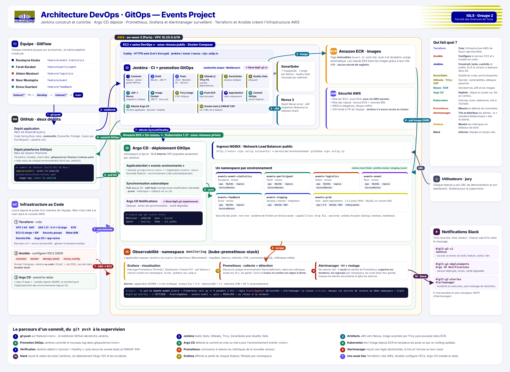

# Plateforme Events — Infrastructure as Code et GitOps

Le dossier `platform/` du dépôt unique `IGL5-G2-EventsProjetcs` contient l'infrastructure AWS, la configuration des outils DevOps et les manifestes Argo CD du projet Events (FST, IGL5 groupe 2). Le code Spring Boot, les tests et le `Jenkinsfile` sont à la racine du dépôt ([README principal](../README.md)). Les chemins ci-dessous sont relatifs à `platform/`.

Terraform crée les ressources AWS et amorce Argo CD. Ansible configure l'EC2 d'outillage. Argo CD déploie ensuite les applications à partir de Git. Jenkins construit, teste et publie les artefacts, puis écrit le tag voulu dans `envs/<env>/` sur la branche orpheline `gitops`; Jenkins n'a pas d'accès direct au cluster.

## Architecture et arborescence



```text
terraform/                         AWS, EKS, ECR, Argo CD, handoff Ansible
ansible/
  site.yml                         ordre des rôles de configuration
  group_vars/devops/               variables d'environnement et Vault example
  roles/
    common/                        paquets et réglages système
    docker/                        Docker Engine et Compose
    devops_stack/                  Caddy, Jenkins/JCasC, Nexus, SonarQube
    sonar_config/                  santé, mot de passe, webhook, jeton Sonar
    github_webhook/                webhook push/Pull Request idempotent
    nexus_config/                  mot de passe admin et accès anonyme
gitops/
  charts/events-app/               application, MySQL, Ingress, métriques, HPA
  platform/apps/                   Applications Argo CD et ApplicationSet
  platform/storage-class/          StorageClass gp3 chiffrée
  platform/monitoring-config/      alertes Prometheus et dashboard Grafana
scripts/                           bootstrap-state, post-apply, destroy
Makefile                           commandes d'exploitation documentées
```

Branche `gitops` (orpheline, hors de `main`) : `envs/<env>/{config.json,values.yaml}`, état produit par Jenkins.

Flux de livraison : `git push` → GitHub webhook → Jenkins Multibranch → Maven/tests/scans → Nexus et ECR → commit sur la branche `gitops` → Argo CD → EKS → Prometheus/Alertmanager/Grafana et notifications Slack.

## Terraform : fichiers et ressources

| Fichier | Ressources / responsabilité |
|---|---|
| `terraform/network.tf` | VPC `10.20.0.0/16`, sous-réseaux publics et privés sur deux AZ, Internet Gateway, NAT et routage. |
| `terraform/eks.tf` | Cluster EKS, groupes de nœuds privés et modules complémentaires, dont EBS CSI; API publique restreinte au CIDR administrateur et point d'accès privé activé (nœuds et VPC). En mode lab : `LabRole`, sans IRSA ni rôle IAM créé. |
| `terraform/ecr.tf` | Registre `events-app`, scan et politique de rétention. |
| `terraform/devops-ec2.tf` | EC2 d'outillage, IP élastique, sécurité, IAM/instance profile et clé SSH; sorties limitées à DNS interne et HTTP(S). |
| `terraform/argocd.tf` | Namespace et secrets de monitoring, chart Argo CD 7.7.11 et application racine. |
| `terraform/values/argocd.yaml.tftpl` | Argo CD HTTP interne, compte API Jenkins aux seuls droits `get`/`sync` dans `events/*`, dépôt et notifications Slack. |
| `terraform/ansible-handoff.tf` | Inventaire et variables Ansible générés localement à partir des outputs Terraform. |
| `terraform/variables.tf`, `providers.tf`, `versions.tf` | Entrées AWS, fournisseurs, versions et backend S3 partiel. |
| `terraform/backend.hcl.example` | Exemple de bucket, clé `platform/terraform.tfstate`, région, table DynamoDB et chiffrement. |
| `terraform/terraform.tfvars.example` | Valeurs d'exemple; les vrais `terraform.tfvars` et `backend.hcl` sont ignorés par Git. |
| `terraform/terraform.tfvars.academy.example` | Valeurs AWS Academy : `us-east-1`, `lab_role_arn`, `t3.large`, version Kubernetes en support standard. |
| `scripts/bootstrap-state.sh` | Crée le bucket S3 versionné/chiffré/protégé contre l'accès public et la table DynamoDB à la demande. |

Le backend distant est initialisé depuis un état local : `make bootstrap-state`, copie et renseignement de `terraform/backend.hcl`, puis `make init`. Les détails et les commandes de mise en service sont dans [docs/GUIDE-EXECUTION.md](../docs/GUIDE-EXECUTION.md).

## Ansible : rôles et intégrations

`ansible/site.yml` exécute les rôles dans cet ordre :

| Rôle | Actions |
|---|---|
| `common` | Paquets de base, fuseau `Africa/Tunis`, réglages système nécessaires à SonarQube; en profil mémoire réduite, swap de 8 Go et `vm.swappiness=10`. |
| `docker` | Docker Engine, Compose et journaux. |
| `devops_stack` | Image Jenkins construite depuis `files/jenkins/` (Maven, Docker CLI, AWS CLI, Argo CD CLI, `jq`); Caddy, Jenkins, Nexus, SonarQube/PostgreSQL; configuration JCasC et job Multibranch. |
| `sonar_config` | Attend la santé de SonarQube, remplace `admin/admin` par le mot de passe Vault, configure le webhook interne `http://jenkins:8080/sonarqube-webhook/`, crée au plus un jeton nommé `jenkins` et l'affiche uniquement lors de sa création. |
| `github_webhook` | Via l'API GitHub et `vault_github_token`, crée ou corrige le webhook applicatif `push`/`pull_request` en JSON, sans doublon. |
| `nexus_config` | Change le mot de passe initial de Nexus et désactive l'accès anonyme. |

Secrets d'exemple : `ansible/group_vars/devops/vault.yml.example`. Copiez-le vers `vault.yml`, renseignez les valeurs puis chiffrez-le avec Ansible Vault. Le jeton GitHub doit avoir les portées `repo` et `admin:repo_hook`. Si l'automatisation webhook ne peut pas s'exécuter, la procédure manuelle est documentée dans le guide. Le jeton généré par SonarQube doit être ajouté à `vault_sonar_token` avant de relancer Ansible afin que JCasC le transmette à Jenkins.

## GitOps : chart, environnements et Argo CD

| Chemin | Contenu |
|---|---|
| `gitops/charts/events-app/` | Chart Helm commun : Deployment, Service, Ingress, Secret MySQL, PVC, ServiceMonitor et HPA; profils `values-review.yaml`, `values-staging.yaml`, `values-prod.yaml`. Les conteneurs applicatifs/MySQL sont durcis et les volumes persistants utilisent `gp3`. |
| `envs/staging/` et `envs/prod/` (branche `gitops`) | Tags initiaux, hôtes et configuration; Jenkins maintient les tags, `make post-apply` les hôtes. |
| `gitops/platform/apps/00-project.yaml` | AppProject `events`, destinations seulement `events-*`, ressource Namespace autorisée. |
| `gitops/platform/apps/10-ingress-nginx.yaml` | Ingress et load balancer public. |
| `gitops/platform/apps/15-ebs-storageclass.yaml` | Application Argo CD qui déploie la StorageClass cluster-scoped. Elle utilise le projet `default` afin que la ressource de cluster soit autorisée. |
| `gitops/platform/storage-class/gp3.yaml` | Provisionneur EBS CSI, volume `gp3` chiffré, `WaitForFirstConsumer`, `reclaimPolicy: Delete`. |
| `gitops/platform/apps/20-monitoring.yaml` | Prometheus, Alertmanager et Grafana. |
| `gitops/platform/apps/30-monitoring-config.yaml` | Application de configuration de supervision. |
| `gitops/platform/apps/40-events-environments.yaml` | ApplicationSet multi-sources : chaque `envs/<env>/config.json` de la branche `gitops` devient `events-<env>`; chart lu sur `main`, `values.yaml` lu sur `gitops` (`ref: values`). |

L'ApplicationSet et ses Applications ont une destination `events-*`; la StorageClass est une ressource de plateforme déployée séparément par l'application du projet `default`.

## Supervision

Le chart expose Actuator/Prometheus sur `/events/actuator/prometheus`, ainsi que trois métriques métier : `fst_events_count`, `fst_participants_count`, `fst_logistics_reserved_cost`. Prometheus découvre les environnements via ServiceMonitor, conserve les métriques sept jours et évalue :

| Alerte | Condition | Gravité |
|---|---|---|
| `EventsAppDown` | Application indisponible pendant plus de 2 minutes. | Critique |
| `EventsHighErrorRate` | Taux d'erreurs HTTP 5xx supérieur à 5 % pendant 5 minutes. | Avertissement |
| `EventsHighLatencyP95` | Latence p95 supérieure à 1 s pendant 10 minutes. | Avertissement |
| `EventsJvmHeapHigh` | Heap JVM au-dessus de 85 % pendant 10 minutes. | Avertissement |

Alertmanager publie les incidents/résolutions dans `#igl5-g2-alertes`; Jenkins publie dans `#igl5-g2-ci`; Argo CD publie dans `#igl5-g2-deploiements`. Le dashboard Grafana « Events FST · par feature » est défini dans `gitops/platform/monitoring-config/grafana-dashboard-configmap.yaml`.

## Makefile

Toutes les cibles sont listées par `make help`; elles impriment leur action avant exécution. La région AWS (`AWS_REGION`, sinon `aws configure get region`, sinon `eu-west-3`) est affichée par `make help` et exportée à tous les scripts.

| Cible | Effet |
|---|---|
| `make bootstrap-state` | Crée le backend S3/DynamoDB (nécessite AWS CLI et autorisation explicite). |
| `make init` | Initialise Terraform avec `terraform/backend.hcl`. |
| `make plan` | Affiche le plan; ne modifie pas l'infrastructure. |
| `make apply` | Applique Terraform et crée/modifie les ressources AWS. |
| `make kubeconfig` | Configure `kubectl` pour le cluster EKS. |
| `make configure` | Installe les collections et exécute le playbook Ansible (Vault requis). |
| `make post-apply` | Découvre les deux NLB, écrit `ansible/group_vars/devops/runtime.yml` (ignoré par Git) et crée un commit local des hôtes staging/prod sur `gitops`, sans push. |
| `make grafana-ui` | Ouvre Grafana en port-forward sur `localhost:3000` (pas d'ingress Grafana). |
| `make argocd-ui` | Ouvre le port-forward local de l'interface Argo CD. |
| `make argocd-token` | Affiche la commande de génération du jeton API pour le compte Jenkins. |
| `make status` | Montre Applications Argo CD, pods et URL des outils. |
| `make destroy` | Nettoie les ressources Kubernetes puis demande confirmation avant `terraform destroy`. |

## AWS Academy (Learner Lab)

Le même code fonctionne sur un compte AWS classique et sur AWS Academy; le mode lab s'active seulement si `lab_role_arn` est renseigné.

| Limite Academy | Réponse du projet |
|---|---|
| Régions `us-east-1` / `us-west-2` | `terraform/terraform.tfvars.academy.example` (`us-east-1`); Makefile et scripts reprennent la région de la configuration AWS CLI et refusent d'agir sur un cluster d'une autre région. |
| Instances `large` au maximum, 9 instances, 32 vCPU | `t3.large` pour l'EC2 DevOps et les nœuds : 5 instances et 10 vCPU au plus. |
| Aucun rôle IAM créable | `LabRole` (EKS, nœuds) et `LabInstanceProfile` (EC2); `enable_irsa = false`. Aucun rôle, politique, profil d'instance ni fournisseur OIDC IAM créé (vérifié par `terraform test` avec fournisseurs simulés). |
| Identifiants temporaires | À recopier dans `~/.aws/credentials` à chaque séance, puis `make kubeconfig`. |
| 8 Go de RAM sur `t3.large` | Profil Ansible « mémoire réduite » automatique sous 12 000 Mo : swap 8 Go, Jenkins `-Xmx1g` et 1 exécuteur, Nexus `-Xmx1g`. |

Sous Windows, travaillez dans le home WSL (`~/`), pas sous `/mnt/c` : Ansible y ignore `ansible.cfg` (dossier en écriture pour tous) et ne trouve plus l'inventaire. Procédure complète : [guide, section 1 bis](../docs/GUIDE-EXECUTION.md#1-bis-aws-academy-learner-lab).

## Documentation

- [Guide d'exécution](../docs/GUIDE-EXECUTION.md) — prérequis, configuration, secrets, déploiement, validations et destruction.
- [Rapport de réalisation](../docs/RAPPORT-REALISATION.md) — changements, validation locale, risques restants et index des fichiers.
- [Architecture](../docs/architecture.png) · [Pipeline DevOps](../docs/pipeline-devops.png) · [Rapport projet v4](../docs/Rapport-DevOps-Events-FST-v4.pdf).

Les scripts d'exploitation n'ont pas été exécutés contre AWS ni un cluster dans le cadre de cette réalisation. Les commandes `make apply`, `make bootstrap-state` et `make destroy` peuvent créer des coûts ou supprimer des ressources : elles doivent être lancées explicitement par une personne autorisée.
